<div align="center">


# Le Petit Grand Livre

**Les finances des communes, en clair.**

Une plateforme citoyenne et associative qui rassemble les comptes publics des communes et les documents obtenus auprès des mairies (budgets, factures, indemnités des élus), les occulte, les vérifie et les rend lisibles par tous.

[Site en ligne](https://lpgl.antaria-systems.fr) · [Méthodologie](https://lpgl.antaria-systems.fr/methodologie) · [Documentation](#documentation) · [Démarrage rapide](#démarrage-rapide)


</div>


---

## Sommaire

- [En deux mots](#en-deux-mots)
- [Ce que voit un habitant](#ce-que-voit-un-habitant)
- [Comment ça marche](#comment-ça-marche)
- [Fonctionnalités](#fonctionnalités)
- [Visite en images](#visite-en-images)
- [Architecture en bref](#architecture-en-bref)
- [Démarrage rapide](#démarrage-rapide)
- [Documentation](#documentation)
- [Principes](#principes)
- [Qui fait quoi, licences et contact](#qui-fait-quoi-licences-et-contact)

---

## En deux mots

Les comptes des communes sont publics, mais dispersés et illisibles pour la plupart des habitants. Les pièces qui permettent de comprendre une dépense (devis, factures, délibérations, état des indemnités des élus) sont communicables à toute personne qui les demande, au titre du **droit d'accès aux documents administratifs** (article L.311-1 du code des relations entre le public et l'administration, ou CRPA). Pourtant, presque personne ne les demande.

Le Petit Grand Livre fait trois choses :

1. **il importe les comptes publiés en open data** par l'Observatoire des finances et de la gestion publique locales (OFGL) pour chaque commune, depuis 2018, et les compare aux communes de même taille ;
2. **il demande le reste aux mairies** : une seule demande groupée par commune et par an, envoyée et suivie depuis la plateforme (relances, saisine de la CADA) ;
3. **il occulte, vérifie puis publie** les documents reçus : coordonnées personnelles, données bancaires et signatures sont masquées, chaque zone est vérifiée à la main, et la version publiée est reconstruite en images (aucun texte ne subsiste sous les masques).

La plateforme est éditée par l'association **Antaria Systems**. Elle démarre dans l'Aude (Lavalette, commune pilote) et s'étend département par département.

> Ce n'est pas un site de l'État ni d'une collectivité : c'est une initiative associative et indépendante.

---

## Ce que voit un habitant

Chaque commune a sa **fiche**, organisée comme un rapport financier lisible : l'essentiel en quelques phrases, le budget, les travaux, les élus, puis tous les documents.

| | |
|---|---|
| 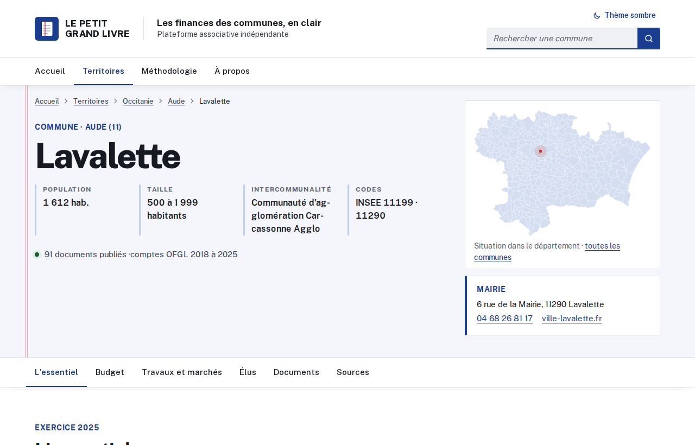 | 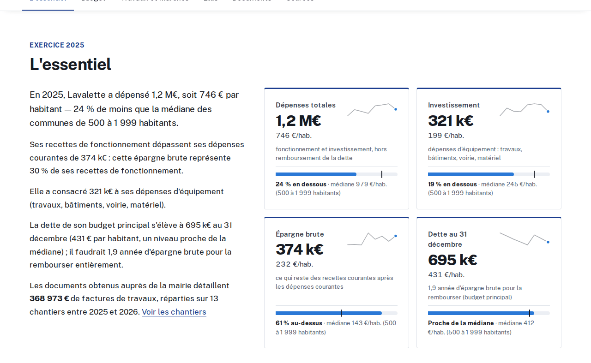 |
| **En-tête** : identité de la commune, carte de situation, coordonnées de la mairie, nombre de documents publiés. | **L'essentiel** : quelques phrases qui résument l'exercice (dépenses, épargne, dette), et quatre chiffres comparés à la médiane des communes de même taille. |
| 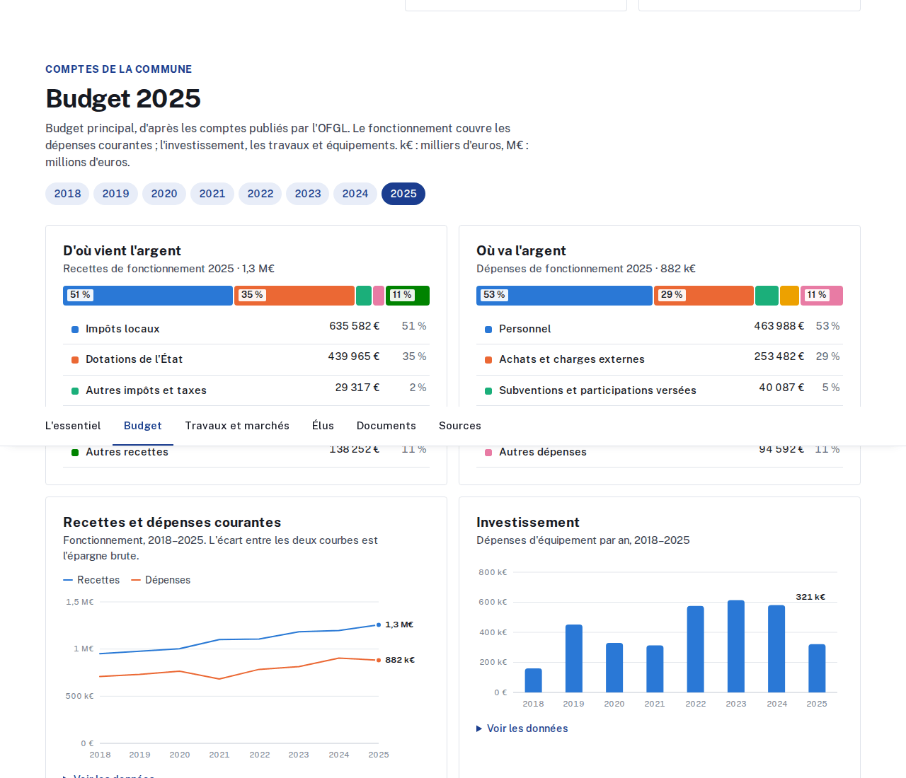 | 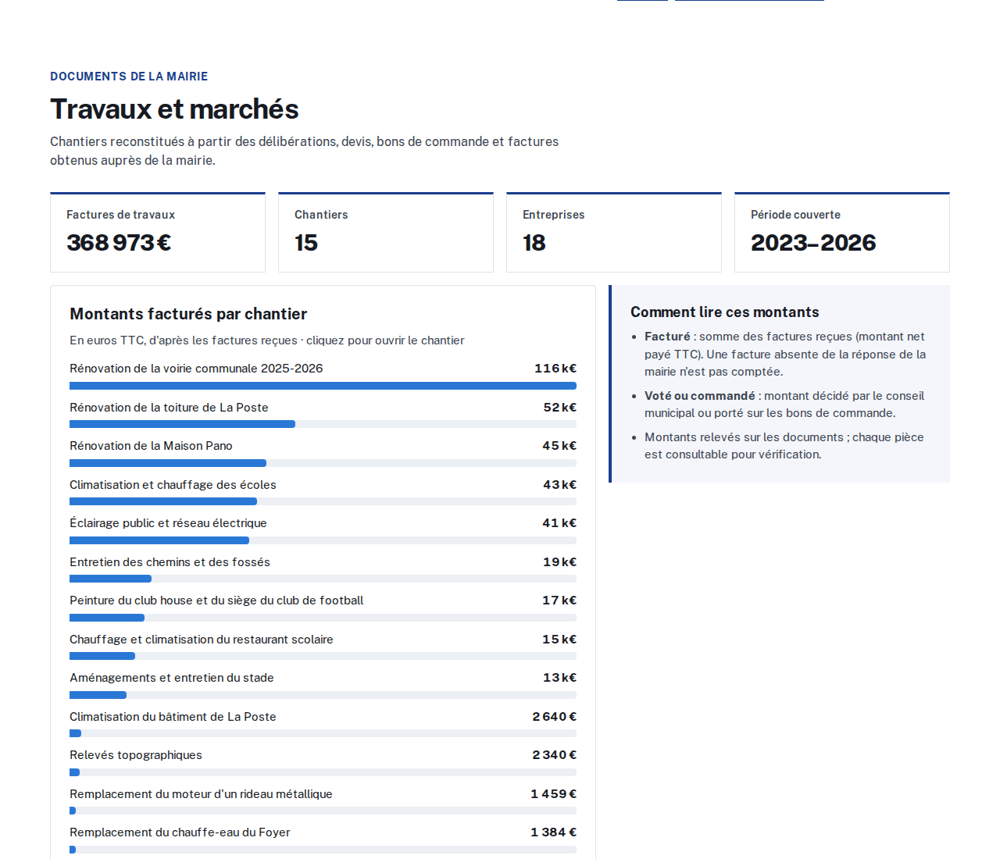 |
| **Budget** : d'où vient l'argent, où il va, évolution depuis 2018, investissement, dette ; chaque graphique a son tableau de données. | **Travaux et marchés** : chantiers reconstitués à partir des délibérations, devis, bons de commande et factures, avec le montant réellement facturé. |
| 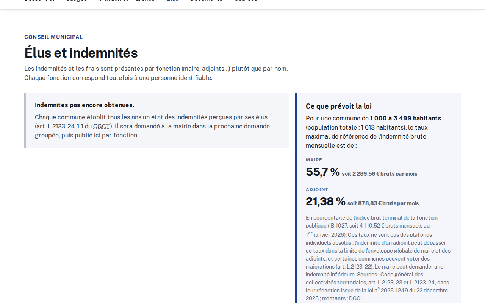 | 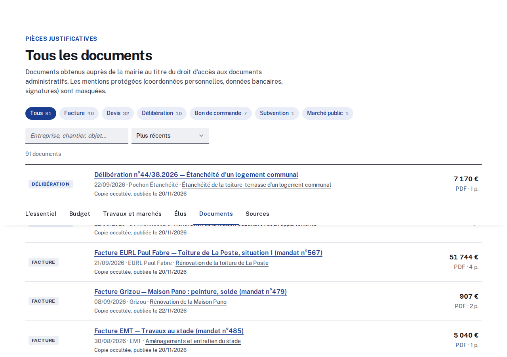 |
| **Élus** : indemnités et frais par fonction, et le barème légal de référence (loi du 22 décembre 2025), avec ses nuances. | **Documents** : toutes les pièces publiées, filtrables et téléchargeables (copies occultées, en PDF). |

Le guide complet de lecture d'une fiche, indicateur par indicateur, est dans [docs/guide-lecture.md](docs/guide-lecture.md).

---

## Comment ça marche

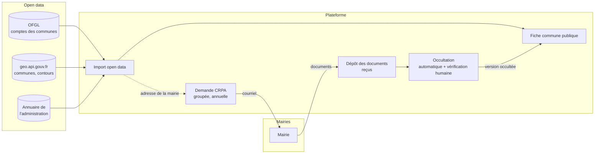

1. **Les données publiques** (comptes, contours, coordonnées des mairies) sont importées automatiquement pour chaque département couvert.
2. **La demande** est préparée, relue puis envoyée (ou programmée) depuis l'administration ; les délais légaux (réponse sous un mois, saisine de la CADA sous deux mois) sont suivis.
3. **Les documents reçus** sont déposés, chiffrés, analysés (OCR et détection des coordonnées, IBAN, signatures), vérifiés à la main, puis publiés dans une version reconstruite en images.

Détails : [docs/demandes-crpa.md](docs/demandes-crpa.md) et [docs/documents-occultation.md](docs/documents-occultation.md).

---

## Fonctionnalités

### Pour le public

- **Recherche de commune** par nom ou code postal, tolérante aux abréviations (« St », « Ste ») et aux fautes de frappe ; fonctionne aussi sans JavaScript.
- **Navigation par territoire** : régions, départements (index alphabétique et filtre des communes), fiches.
- **Fiche commune** : résumé en langage clair, budget de fonctionnement et d'investissement, dette et capacité de désendettement, comparaison aux médianes nationales de la strate, chantiers et factures, indemnités et frais des élus par fonction, historique des demandes, bibliothèque de documents.
- **Données ouvertes** : export CSV des comptes de chaque commune (source, licence, date de mise à jour), sous Licence Ouverte 2.0.
- **Accessibilité** (référentiel RGAA / WCAG 2.2 AA) : navigation au clavier, lecteurs d'écran, contrastes, texte agrandi, mode contrasté de Windows, thème sombre.
- **Partage** : chaque fiche a son image de partage générée (nom, population, dette par habitant, documents publiés).

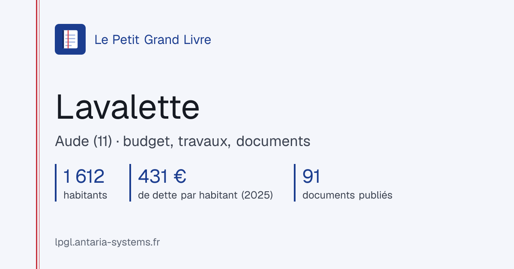

### Pour l'équipe (administration)

- **Tableau de bord « à faire »** : documents à vérifier ou bloqués par le contrôle, échéances des demandes, envois programmés, état du traitement en arrière-plan.
- **Territoires** : activation d'un département (import automatique des communes, de la carte, des comptes et des coordonnées des mairies).
- **Dépôt de documents** : PDF, images ou archives ZIP, par glisser-déposer ; chiffrement à l'entrée, dédoublonnage, classement automatique.
- **Éditeur d'occultation** : zones proposées automatiquement, vérification au clavier (Tab, Entrée, Suppr, Ctrl+Z), zoom, reprise des zones d'un document au même modèle, « Terminer » qui génère et publie.
- **Demandes CRPA / CADA** : courrier type adapté à la taille de la commune, envoi immédiat ou programmé (y compris en lot pour tout un département, étalé dans le temps), relances préremplies, aide à la saisine de la CADA, journal des échanges.
- **Recherche rapide** (Ctrl+K) pour ouvrir une commune dans l'administration.

Le guide d'utilisation de l'administration est dans [docs/administration.md](docs/administration.md).

### Garanties

| Risque | Garantie |
|---|---|
| Publier une donnée personnelle | Détection automatique, vérification humaine de chaque zone, version publique **reconstruite en images**, contrôle automatique avant publication (courriels, IBAN, RIB, n° de sécurité sociale, mobiles) qui bloque la mise en ligne. |
| Publier une version obsolète | Chaque modification incrémente la **révision** du document : une génération lancée avant la modification est jetée, jamais publiée. |
| Envoyer deux fois une demande à une mairie | **Réservation atomique** avant tout appel au serveur de messagerie ; un état incertain est signalé « ne pas renvoyer ». |
| Fuite des originaux | Originaux et aperçus **chiffrés** (AES-256-GCM), jamais servis au public, supprimés cinq ans après publication. |
| Compromission par un fichier piégé | Le traitement des documents tourne **sans accès à Internet**, sans le relais de messagerie ni les secrets de connexion, dans un conteneur en lecture seule. |
| Perte de données | Sauvegarde quotidienne chiffrée (base, documents, configuration), copie hors du serveur, restauration testée. |

---

## Visite en images

| Territoires | Département |
|---|---|
| 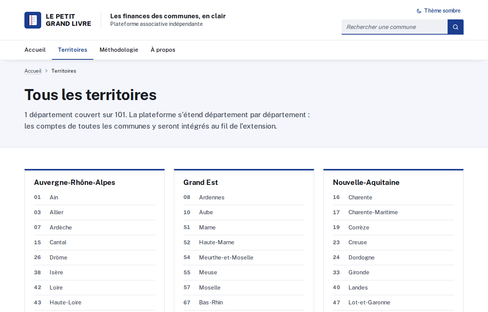 | 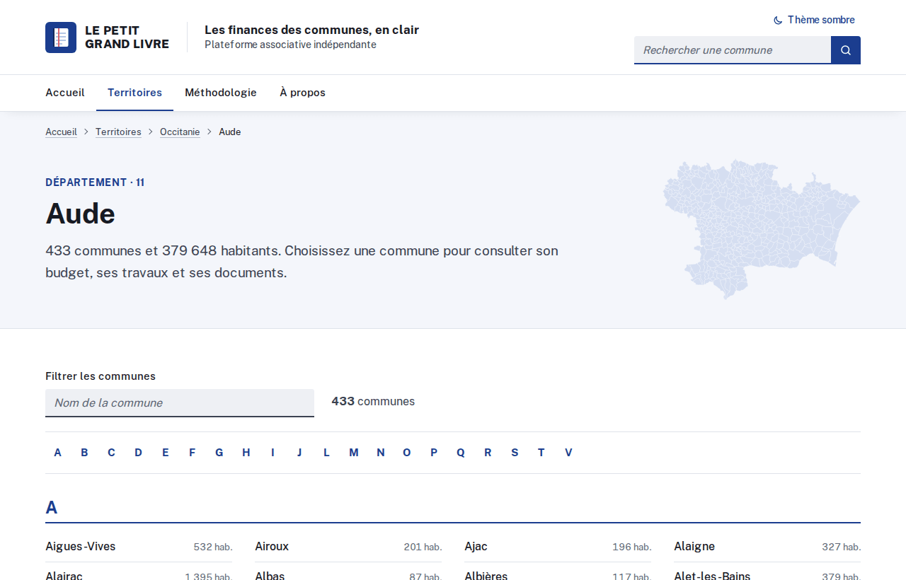 |

| Comparaison avec les communes de même taille | Sources et méthode |
|---|---|
| 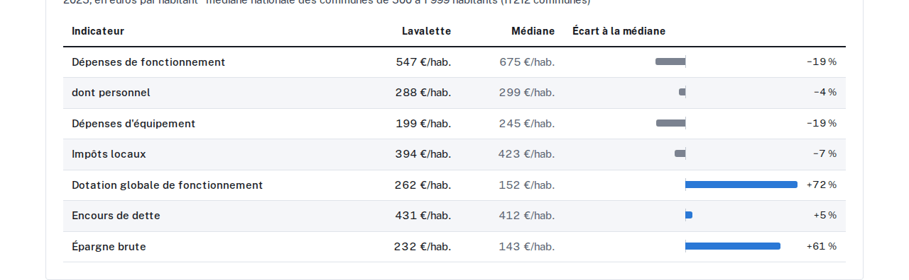 | 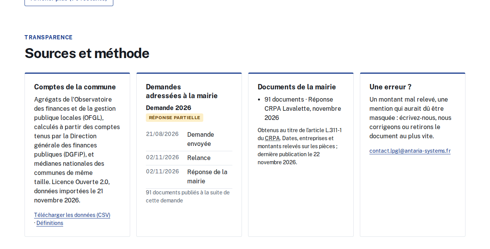 |

| Thème sombre | Méthodologie |
|---|---|
| 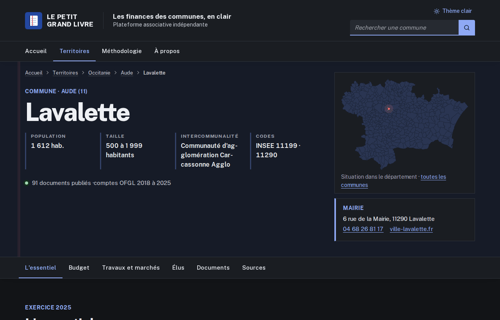 | 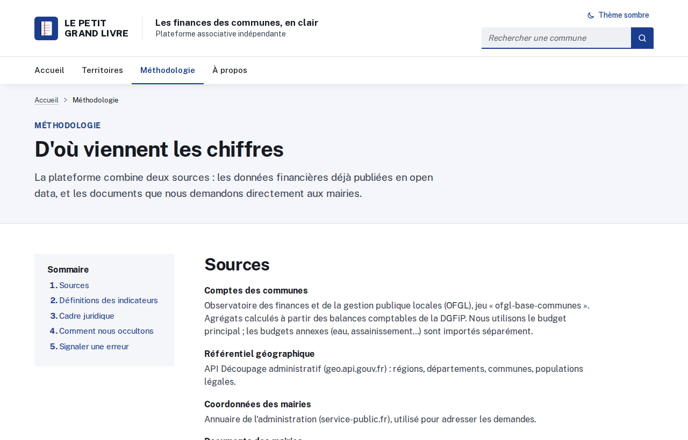 |

| Mobile : fiche | Mobile : l'essentiel | Mobile : menu |
|---|---|---|
| 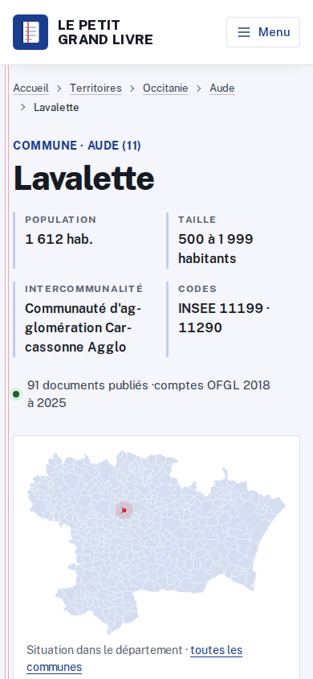 | 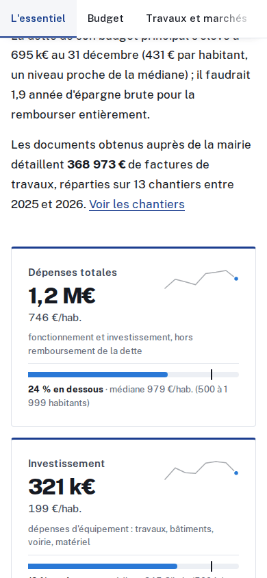 |  |

---

## Architecture en bref

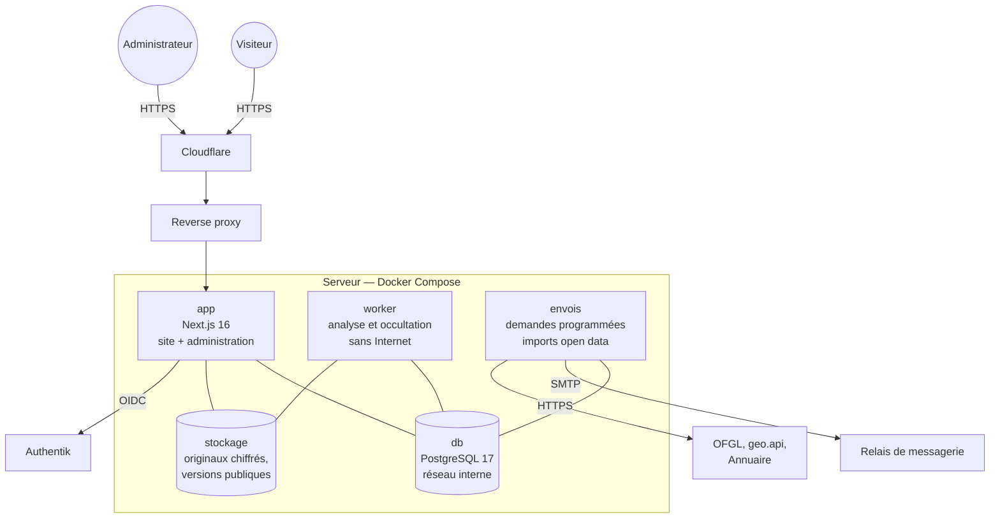

- **Application** : Next.js 16 (App Router, rendu serveur), React 19, TypeScript.
- **Données** : PostgreSQL 17 via Prisma 7 (adaptateur `pg`).
- **Connexion** : Auth.js v5 avec Authentik (OIDC), réservée à un groupe.
- **Traitement des documents** : poppler (rendu), tesseract (OCR français), sharp, pdf-lib.
- **Messagerie** : nodemailer vers un relais SMTP.
- **Exploitation** : Docker Compose, conteneurs durcis, sauvegardes systemd, déploiement réversible.

Tout est détaillé dans [docs/architecture.md](docs/architecture.md).

---

## Démarrage rapide

### Développement

Prérequis : Node.js 24, Docker.

```sh
git clone https://github.com/Antaria-Systems/Le-Petit-Grand-Livre.git
cd Le-Petit-Grand-Livre
cp .env.example .env      # remplir au minimum POSTGRES_*, DATABASE_URL, ORIGINALS_KEY (openssl rand -hex 32)
npm ci
docker compose -f docker-compose.yml -f docker-compose.dev.yml up -d db   # Postgres sur localhost:5433
npx prisma migrate deploy
npm run import:all        # référentiel, comptes OFGL et mairies des départements de DEPARTEMENTS_ACTIFS
ADMIN_BASIC=1 ADMIN_USER=admin ADMIN_PASSWORD="$(openssl rand -base64 24)" npm run dev   # http://localhost:3000
npm run worker            # dans un autre terminal : analyse des documents, envois programmés
```

> En développement, l'administration est accessible en HTTP Basic (`ADMIN_BASIC=1`). En production, seule la connexion Authentik est possible.

### Tests

```sh
npm run typecheck
npm test                                    # tests sans base
TEST_DATABASE_URL=postgresql://… npm test   # + tests d'envoi (transport factice, aucun courriel)
```

### Production

```sh
scripts/exploitation/deployer.sh   # construit, étiquette (commit), migre, redémarre ; retour arrière possible
```

Installation complète (Authentik, relais SMTP, rôle de base de données, reverse proxy) : [docs/installation.md](docs/installation.md). Exploitation au quotidien : [docs/exploitation.md](docs/exploitation.md).

---

## Documentation

| Document | Pour qui | Contenu |
|---|---|---|
| [Guide de lecture d'une fiche](docs/guide-lecture.md) | Tout le monde | Chaque section et chaque indicateur expliqués, médianes, limites des chiffres. |
| [Données financières](docs/donnees-financieres.md) | Curieux, réutilisateurs | Sources, imports, calculs (communes nouvelles, population totale), médianes, export CSV. |
| [Demandes CRPA et CADA](docs/demandes-crpa.md) | Équipe, curieux | Cadre légal, courrier type, envoi, garanties anti-doublon, délais, relances, CADA. |
| [Documents et occultation](docs/documents-occultation.md) | Équipe | Dépôt, analyse, détection, éditeur, génération, contrôle, publication, conservation. |
| [Guide de l'administration](docs/administration.md) | Équipe | Pas à pas : tableau de bord, territoires, communes, dépôt, éditeur, demandes. |
| [Architecture](docs/architecture.md) | Développeurs | Services, code, modèle de données, flux, choix techniques. |
| [Installation](docs/installation.md) | Administrateurs système | Variables d'environnement, première installation, Authentik, SMTP, reverse proxy. |
| [Exploitation](docs/exploitation.md) | Administrateurs système | Déploiement, retour arrière, sauvegardes, supervision, incidents. |
| [Sécurité](docs/securite.md) | Tous | Modèle de menace, mesures en place, signaler une faille. |
| [Cadre juridique](docs/cadre-juridique.md) | Tous | CRPA, réutilisation, RGPD, mentions légales, neutralité, licences. |
| [Interface et accessibilité](docs/interface.md) | Développeurs, designers | Identité visuelle, composants, graphiques, accessibilité, référencement. |
| [Contribuer](docs/contribuer.md) | Développeurs | Conventions, tests, commits, revue. |
| [Documents RGPD](docs/rgpd/) | Association | Registre, mise en balance de l'intérêt légitime, analyse d'impact. |

---

## Principes

- **Les faits, pas des jugements.** Les chiffres sont comparés à une médiane, sans couleur « bonne » ou « mauvaise » : un écart n'est pas une faute. Les plafonds d'indemnités sont présentés comme des taux de référence, avec leurs nuances légales.
- **Les données personnelles protégées.** Seules les informations utiles à la compréhension de la dépense publique sont publiées. Les indemnités et frais des élus sont présentés par fonction ; les coordonnées et données bancaires sont toujours masquées.
- **Ménager les mairies.** Une seule demande groupée par commune et par an, ciblée pour les grandes communes dont les budgets et délibérations sont déjà en ligne.
- **Tout est vérifiable.** Chaque montant renvoie à sa pièce, chaque chiffre à sa source et à sa date, et le code est ouvert.
- **Indépendance.** La plateforme n'est rattachée ni à l'État, ni à une collectivité, ni à un parti.

---

## Qui fait quoi, licences et contact

- **Éditeur** : association Antaria Systems (RNA W111010088), 3 chemin de la Malepère, 11290 Lavalette.
- **Contact** : contact.lpgl@antaria-systems.fr — une erreur sur une fiche, une mention qui aurait dû être masquée : écrivez-nous, nous corrigeons au plus vite.
- **Code** : licence [GNU AGPL-3.0](LICENSE). Toute version modifiée mise en ligne doit publier son code source.
- **Données** : [Licence Ouverte 2.0](https://www.etalab.gouv.fr/licence-ouverte-open-licence/) (Etalab) : réutilisation libre en mentionnant la source et la date de mise à jour. Les documents reproduits restent soumis, le cas échéant, aux droits de leurs auteurs.
- **Sources** : OFGL (comptes des communes, d'après la DGFiP), geo.api.gouv.fr (référentiel, contours IGN), Annuaire de l'administration (coordonnées des mairies), documents communiqués par les mairies.
- **Sécurité** : voir [SECURITY.md](SECURITY.md) pour signaler une vulnérabilité.
