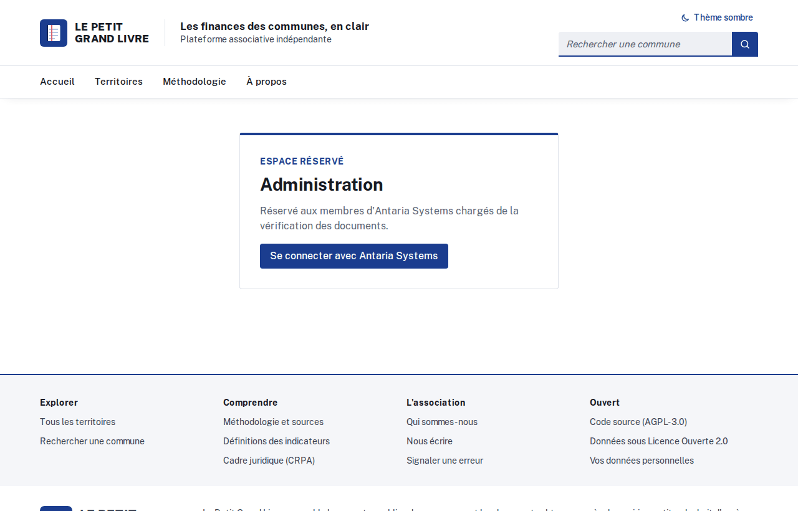
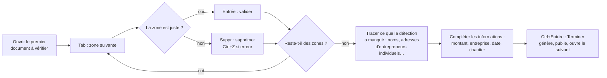

# Guide de l'administration

Le mode d'emploi de l'espace d'administration, écran par écran, pour l'équipe qui dépose les documents, les vérifie et envoie les demandes aux mairies.

← [Retour au README](../README.md)

> Les captures de l'administration ne figurent pas dans cette documentation publique : elles montreraient des documents non occultés et des demandes en cours.

---

## Sommaire

1. [Se connecter](#1-se-connecter)
2. [La barre d'administration](#2-la-barre-dadministration)
3. [Le tableau de bord](#3-le-tableau-de-bord)
4. [Territoires : couvrir un département](#4-territoires--couvrir-un-département)
5. [La fiche d'administration d'une commune](#5-la-fiche-dadministration-dune-commune)
6. [Déposer des documents](#6-déposer-des-documents)
7. [La liste des documents](#7-la-liste-des-documents)
8. [Vérifier et publier un document](#8-vérifier-et-publier-un-document)
9. [Les demandes CRPA / CADA](#9-les-demandes-crpa--cada)
10. [Journées types](#10-journées-types)
11. [En cas de problème](#11-en-cas-de-problème)

---

## 1. Se connecter

- Adresse : `/admin` (ou `/connexion`).
- Connexion par **Authentik** (« Se connecter avec Antaria Systems »). Seuls les membres du groupe d'administration configuré (`AUTH_ADMIN_GROUP`) ont accès ; les autres comptes voient « Ce compte n'est pas autorisé à administrer la plateforme ».
- Une session dure **24 heures au plus** ; il faut ensuite se reconnecter.
- « Se déconnecter » est dans la barre d'administration.

---

## 2. La barre d'administration

En haut de chaque écran : **Administration** (tableau de bord) · **Territoires** · **Demandes** · **Documents** · **Déposer** · champ **Commune… (Ctrl+K)** · votre nom · **Site public ↗** · thème clair/sombre · **Se déconnecter**.

**Ctrl+K** (ou ⌘K) place le curseur dans la recherche : tapez quelques lettres d'une commune, Entrée, et sa fiche d'administration s'ouvre directement.

---

## 3. Le tableau de bord

Il répond à la question « qu'est-ce que j'ai à faire ? ».

| Bloc | Contenu |
|---|---|
| **Alerte rouge** (si besoin) | « Le traitement des envois ne répond plus » : les envois programmés ne partiront pas tant que le worker n'est pas relancé. |
| **Chiffres clés** | Documents à vérifier · Bloqués par le contrôle · En file d'analyse · Publiés · Demandes en cours (chacun est un lien). |
| **À faire** | Documents bloqués (une coordonnée reste lisible), documents reçus il y a plus d'une heure et pas encore analysés, puis les demandes à suivre, les plus urgentes d'abord (échec d'envoi, CADA à saisir, réponse attendue sous peu). Brouillons prêts à relire. Communes du périmètre sans courriel de mairie. |
| **Envois programmés** | Commune et date et heure de chaque envoi à venir. |
| **Traitement en arrière-plan** | État des deux workers (« Actif, dernier signal il y a 12 s » ou « Sans signal »). |
| **Territoires couverts** | Départements actifs, lien pour en couvrir un nouveau, derniers imports et leur état. |

---

## 4. Territoires : couvrir un département

**Territoires** → région : la liste de ses départements, avec leur état et leurs documents.

- Un département non couvert propose **« Couvrir et importer »** : la plateforme importe ses communes, la carte, les comptes OFGL depuis 2018 et les coordonnées des mairies (quelques minutes, badge « Import en cours »). Le suivi apparaît dans « Imports récents » du tableau de bord.
- La page d'un département couvert liste ses communes : population, documents publiés, documents à traiter, chantiers, dernière demande, présence d'un courriel de mairie ; recherche et filtres (avec des documents, avec une demande, sans demande).
- Le volet **« Demandes {année} en lot »** prépare puis programme les demandes de tout le département (voir [section 9](#9-les-demandes-crpa--cada)).
- **« Retirer »** masque le département du site sans effacer ses données.

---

## 5. La fiche d'administration d'une commune

Accès : Ctrl+K, ou Territoires → … → commune. Boutons « Déposer des documents » et « Fiche publique ↗ ». Cinq onglets :

| Onglet | Ce qu'on y fait |
|---|---|
| **Informations** | Adresse, téléphone, **courriel (destinataire des demandes)** et site de la mairie ; texte de présentation publié sur la fiche ; notes internes (jamais publiées). Corriger le courriel met à jour les brouillons non envoyés. |
| **Chantiers** | Créer ou modifier un chantier : intitulé, catégorie, lieu, description, entreprise, statut (prévu, en cours, réalisé), année, montants votés TTC et HT, documents rattachés. |
| **Documents** | Tous les documents de la commune et leur statut, avec un lien vers l'éditeur. |
| **Élus** | Indemnités (année, fonction, ordre d'affichage, montant brut annuel, justificatif) et frais (fonction, nature, libellé, date, montant, justificatif). Le justificatif doit être un document de la même commune. |
| **Demandes CRPA / CADA** | Préparer, relire, envoyer ou programmer la demande de l'année ; relancer ; saisir la CADA ; tenir le journal ; rattacher les documents reçus. |

Les messages de succès ou d'erreur s'affichent sous chaque formulaire. Toute action irréversible (supprimer, envoyer) demande une confirmation.

---

## 6. Déposer des documents

**Déposer** (ou depuis la fiche d'une commune, qui la présélectionne).

1. Choisissez la commune.
2. Glissez les fichiers (PDF, images, ZIP) ou « Choisir des fichiers ». Un fichier ajouté par erreur peut être retiré (« Retirer ») avant l'envoi.
3. Facultatif : catégorie (par défaut « Détection automatique », d'après le nom des dossiers et des fichiers) et nom du lot (par défaut « Dépôt du JJ/MM/AAAA »).
4. « Envoyer N fichiers » : barre de progression par fichier, puis le résultat (importé, doublon, ignoré, erreur) avec un lien vers chaque document.

L'analyse démarre aussitôt (une dizaine de secondes par page). Les documents arrivent dans « Documents à vérifier ». Détails : [documents-occultation.md](documents-occultation.md#3-dépôt).

---

## 7. La liste des documents

**Documents** : les plus récemment reçus d'abord, 50 par page.

- **Filtres par statut** : Tous, Publiés aujourd'hui, Bloqués par le contrôle, À vérifier, Reçu, Analyse en cours, Occulté, Publié, Non publiable.
- **Recherche** dans le titre, l'entreprise ou la commune ; filtres par commune et par lot d'import.
- Pour chaque document : commune, année, lot, date de réception, pages, zones, zones à vérifier, statut, et le message d'erreur éventuel (par exemple le détail d'un blocage).

---

## 8. Vérifier et publier un document

L'éditeur, ses raccourcis et ses règles sont détaillés dans [documents-occultation.md](documents-occultation.md#5-vérification-dans-léditeur). Le parcours habituel :

À surveiller :

- **La détection ne trouve pas tout** : signatures légères, noms manuscrits, adresses d'artisans en entreprise individuelle, informations de vie privée doivent être tracés à la main.
- **Les numéros de téléphone fixes** ne sont pas bloqués par le contrôle : décidez au cas par cas (le numéro de la mairie reste visible).
- Si l'alerte « Le document précédent n'a pas été publié » apparaît, ouvrez-le : une coordonnée est restée lisible.
- En fin de journée, la vue **Documents → Publiés aujourd'hui** permet de relire rapidement les publications automatiques.

---

## 9. Les demandes CRPA / CADA

Le fonctionnement complet (courrier, délais, garanties) est dans [demandes-crpa.md](demandes-crpa.md). En pratique :

### Une commune

1. Onglet **Demandes** → « + Nouvelle demande » : année de la demande, exercice demandé, pièces (cochées selon la taille de la commune) → « Préparer le brouillon ».
2. **Relire** le courrier affiché dans l'encadré d'envoi ; le corriger si besoin dans « Courrier, statut et dates » (formules de politesse, pièces…).
3. Cocher « J'ai relu le courrier ci-dessus et je confirme l'envoi », choisir la copie cachée, puis :
   - **Envoyer maintenant**, ou
   - choisir une date et une heure (heure de Paris) et **Programmer l'envoi** (annulable jusqu'au dernier moment).
4. Ensuite, les échéances s'affichent : réponse attendue au plus tard le…, CADA à saisir au plus tard le…

### Tout un département

Département → **Demandes {année} en lot** :

1. **Préparer les brouillons** (exercice demandé) : un brouillon par commune qui a un courriel et pas encore de demande pour l'année. Rien n'est envoyé à cette étape.
2. Relire les brouillons (au moins ceux des grandes communes) depuis la fiche de chaque commune.
3. **Programmer les envois** : premier envoi (heure de Paris) et nombre d'envois par heure (10 par défaut), case de confirmation. Les envois s'étalent ; chacun reste annulable depuis la fiche de sa commune.

### Suivre

- **Pas de réponse** : volet « Préparer une relance » (texte prérempli, modifiable, envoyé par le même relais, une fois par 24 heures au plus).
- **Refus ou silence d'un mois** : volet « Saisine de la CADA » (texte prêt à copier, lien vers cada.fr, puis « J'ai saisi la CADA » avec la date et le numéro de dossier).
- **Réponse reçue** : « Journal des échanges » → ajouter le message reçu ; mettre le statut (« Documents reçus », « Réponse partielle », « Refusée » avec la date) ; rattacher les documents déposés.

### Si un envoi est bloqué

Un encadré rouge « Envoi bloqué » apparaît si la transmission a été coupée ou si l'enregistrement a échoué après l'envoi. **Avant toute action**, vérifiez la copie cachée dans la boîte de l'association :

- le courriel est arrivé → case « le courriel est parti » → **Marquer comme envoyée** ;
- il n'est pas arrivé → case « le courriel n'est pas parti » → **Débloquer l'envoi**, puis renvoyer.

---

## 10. Journées types

**Réception de documents d'une mairie**

1. Enregistrer les pièces jointes du courriel sur l'ordinateur (puis les supprimer de la messagerie une fois importées).
2. Déposer depuis la fiche de la commune.
3. Journal de la demande : consigner la réponse ; statut « Documents reçus » ou « Réponse partielle » ; rattacher les documents.
4. Vérifier les documents un par un dans l'éditeur (Ctrl+Entrée pour enchaîner).
5. Compléter les chantiers (onglet Chantiers) et les indemnités (onglet Élus).
6. Relire « Publiés aujourd'hui », puis la fiche publique.

**Lancement d'une campagne annuelle**

1. Tableau de bord : vérifier qu'aucune commune du périmètre n'est sans courriel (ou le compléter).
2. Département → préparer les brouillons, relire les grandes communes, programmer les envois étalés.
3. Le lendemain : tableau de bord, aucun échec d'envoi ; contrôle de la copie cachée.
4. Un mois plus tard : relances pour les demandes sans réponse ; deux mois et demi après, saisines de la CADA si nécessaire.

---

## 11. En cas de problème

| Symptôme | Que faire |
|---|---|
| « Le traitement des envois ne répond plus » | Le worker `envois` est arrêté : voir [exploitation.md](exploitation.md#incidents-courants). Les envois en retard de plus de 6 heures ne partent pas d'eux-mêmes : les reprogrammer. |
| Envoi en échec « relais injoignable » ou « IP non autorisée » | Problème du relais de messagerie : vérifier sa configuration, puis renvoyer. |
| Document resté « Reçu » longtemps | Worker `documents` arrêté ou document très long ; un document qui échoue 3 fois est abandonné avec un message : « Réanalyser », découper le PDF ou le marquer « Non publiable ». |
| Document bloqué par le contrôle | Ouvrir le document : le message indique ce qui reste lisible (valeur masquée) ; tracer la zone, puis Terminer. S'il s'agit d'une coordonnée publique, « Publier » manuellement. |
| Document déposé sur la mauvaise commune | Éditeur → « Corriger une erreur de dépôt » → déplacer (code INSEE) ou supprimer s'il n'est pas publié. |
| « La demande a changé depuis l'ouverture de cette page » | Recharger la page puis refaire la modification (protection contre l'écrasement d'un envoi). |
| Une donnée personnelle signalée sur un document publié | Ouvrir le document, tracer la zone (il est dépublié aussitôt), Terminer ; voir aussi le [retrait d'urgence](documents-occultation.md#9-publication-dépublication-retrait-durgence). |
