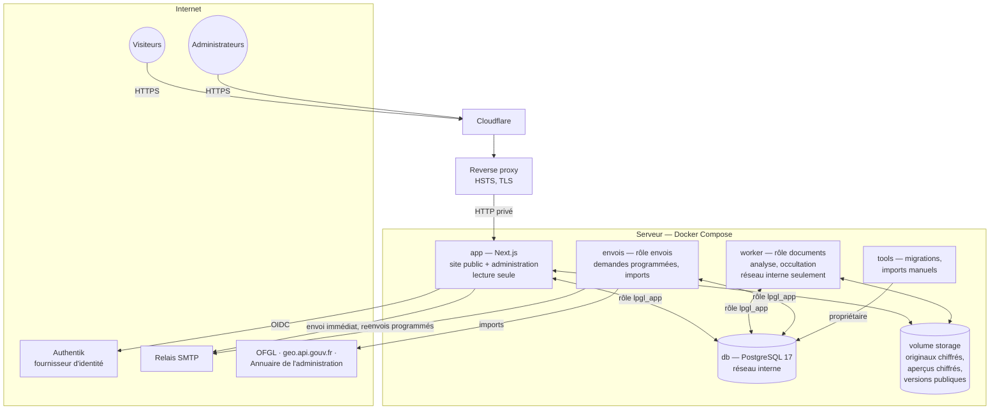
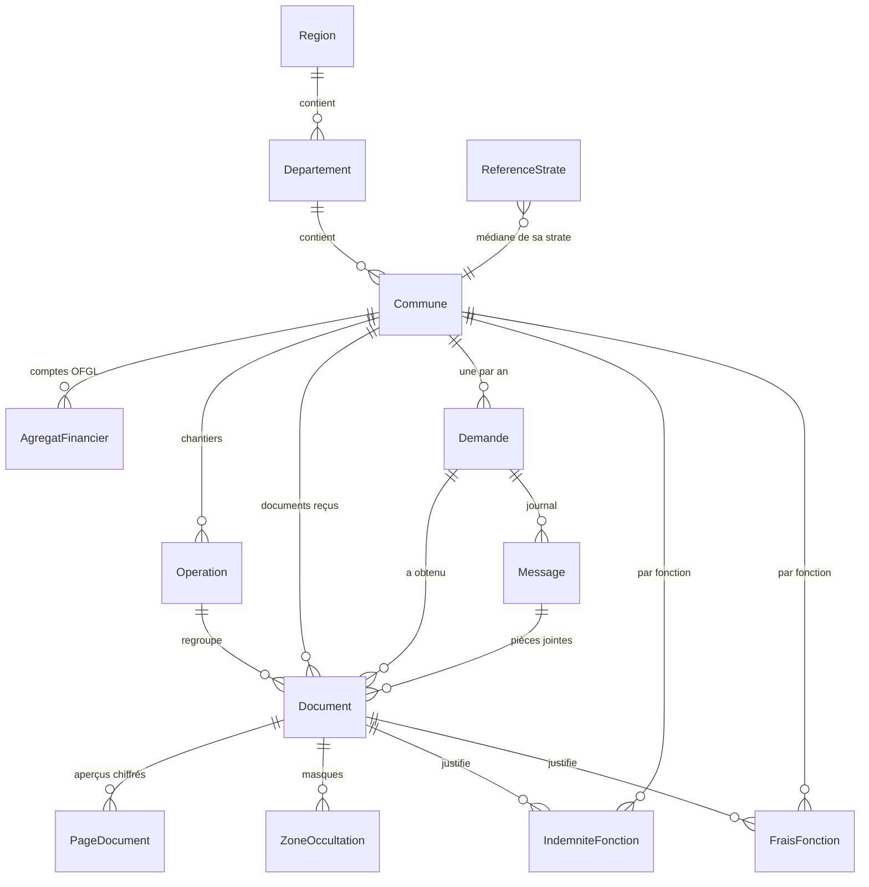
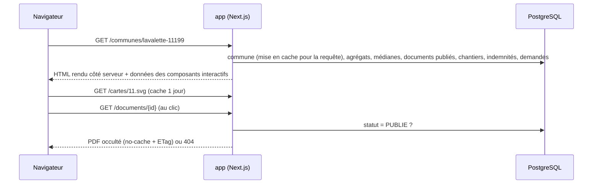
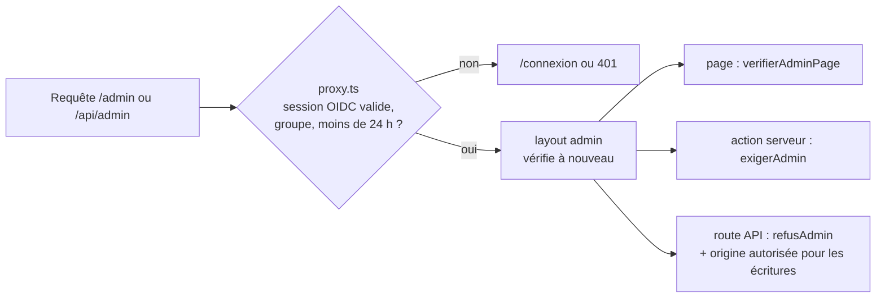
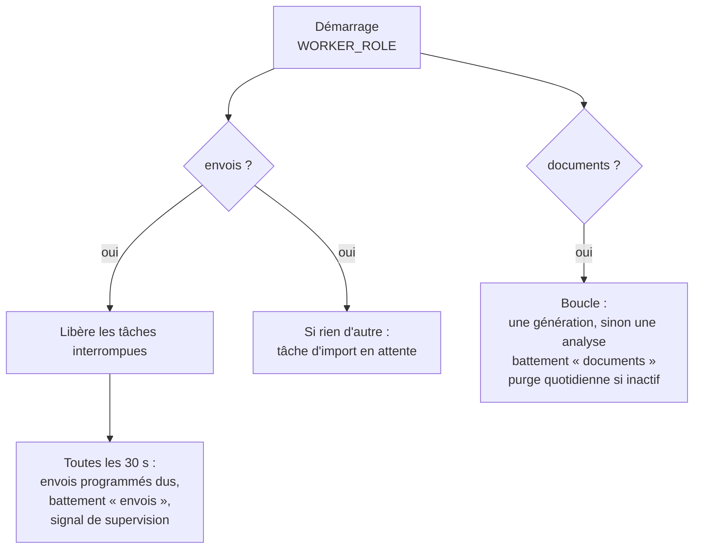

# Architecture

Comment la plateforme est construite : services, organisation du code, modèle de données, flux principaux et choix techniques.

← [Retour au README](../README.md)

---

## Sommaire

1. [Vue d'ensemble](#1-vue-densemble)
2. [Les services](#2-les-services)
3. [Pile technique](#3-pile-technique)
4. [Organisation du code](#4-organisation-du-code)
5. [Modèle de données](#5-modèle-de-données)
6. [Flux principaux](#6-flux-principaux)
7. [Rendu, cache et performances](#7-rendu-cache-et-performances)
8. [Choix techniques et leurs raisons](#8-choix-techniques-et-leurs-raisons)

---

## 1. Vue d'ensemble



La base de données et le worker `documents` sont sur un **réseau Docker interne** (`internal: true`) : ils n'ont aucun accès à Internet.

---

## 2. Les services

| Service | Image | Commande | Réseaux | Rôle |
|---|---|---|---|---|
| `db` | `postgres:17-alpine` | — | interne | Base de données. |
| `app` | `opendata-communes-app` (étape `runner`) | `node server.js` | interne + sortie | Site public, administration, API. Système de fichiers en lecture seule (tmpfs pour `/tmp` et le cache Next). |
| `worker` | `opendata-communes-worker` (étape `tools`) | `node --import tsx scripts/worker.ts`, `WORKER_ROLE=documents` | **interne seulement** | Analyse (rendu, OCR, détection) et génération des versions occultées ; purge des originaux. |
| `envois` | `opendata-communes-worker` | idem, `WORKER_ROLE=envois` | interne + sortie | Envois programmés (boucle de 30 s), tâches d'import open data, signal de supervision. |
| `tools` | `opendata-communes-tools` | à la demande (profil `tools`) | interne + sortie | Migrations Prisma, imports en ligne de commande, scripts. |

Tous les services applicatifs : utilisateur non root (`node`), capacités Linux retirées (`cap_drop: ALL`), `no-new-privileges`, limite de processus, `init`, journaux limités (3 × 10 Mo), limites de mémoire et de CPU, contrôle de santé.

**Secrets par service** (plus de fichier d'environnement commun) :

| Secret | app | worker | envois | tools |
|---|:---:|:---:|:---:|:---:|
| Mot de passe du rôle `lpgl_app` | ✔ | ✔ | ✔ | |
| Mot de passe du propriétaire de la base | | | | ✔ |
| `ORIGINALS_KEY` (clé des originaux) | ✔ | ✔ | | ✔ |
| Secrets Authentik et `AUTH_SECRET` | ✔ | | | ✔ |
| Relais SMTP | ✔ | | ✔ | ✔ |

---

## 3. Pile technique

| Couche | Choix |
|---|---|
| Langage | TypeScript (strict), Node.js 24 |
| Application web | **Next.js 16** (App Router, composants serveur, actions serveur, sortie `standalone`), **React 19** |
| Base de données | **PostgreSQL 17**, **Prisma 7** (client généré dans `src/generated/prisma`, adaptateur `@prisma/adapter-pg`) |
| Connexion | **Auth.js v5** (`next-auth`), fournisseur **Authentik** (OIDC), session JWT de 8 h glissantes, 24 h au plus |
| Validation | **zod** |
| Courriel | **nodemailer** (STARTTLS, TLS 1.2 minimum) |
| Documents | **poppler-utils** (`pdfinfo`, `pdftoppm`, `pdftotext`), **tesseract** 5 (français), **sharp** (images), **pdf-lib** (métadonnées, pied de page), **yauzl** (ZIP) |
| Images de partage | `next/og` (`ImageResponse`) |
| Tests | `node:test` avec `tsx` |
| Conteneurs | Docker Compose, images Debian bookworm (Node 24) |

Pas de framework CSS ni de bibliothèque de composants : une feuille de style unique (`src/app/globals.css`) et des composants maison (voir [interface.md](interface.md)).

---

## 4. Organisation du code

```text
.
├── docker-compose.yml          services, réseaux, secrets par service
├── Dockerfile                  étapes socle → base (poppler, tesseract) → deps → tools / builder → runner
├── prisma/
│   ├── schema.prisma           modèle de données
│   └── migrations/             migrations SQL versionnées
├── scripts/
│   ├── worker.ts               worker (rôles documents / envois / tout)
│   ├── import-*.ts             imports open data et documents
│   ├── masquer-texte.ts, supprimer-lot.ts, detecter-signatures.ts, appliquer-donnees.ts, …
│   └── exploitation/           déploiement, sauvegarde, export pour le PC, scripts Windows
├── src/
│   ├── app/
│   │   ├── layout.tsx          racine : police, thème, métadonnées
│   │   ├── (site)/             site public (mise en page avec en-tête et pied de page)
│   │   │   ├── page.tsx                      accueil
│   │   │   ├── regions/, departements/       territoires
│   │   │   ├── communes/[slug]/              fiche, export CSV, image de partage
│   │   │   ├── recherche/                    recherche sans JavaScript
│   │   │   └── methodologie/, a-propos/, mentions-legales/, connexion/
│   │   ├── admin/              administration (mise en page dédiée) + actions.ts (actions serveur)
│   │   ├── api/                communes (recherche), depot (envoi de fichiers), admin/…, auth/…
│   │   ├── documents/[id]/     PDF publics (versions occultées)
│   │   ├── cartes/[fichier]/   fonds de carte SVG par département
│   │   ├── sitemap.ts, robots.ts, manifest.ts, icon.svg, apple-icon.tsx, opengraph-image.tsx
│   │   └── globals.css
│   ├── components/             en-tête, pied, recherche, fiche/, graphiques/, admin/, og/
│   ├── lib/                    logique métier (voir ci-dessous)
│   ├── auth.ts                 configuration Auth.js
│   ├── proxy.ts                contrôle d'accès en amont de /admin et /api/admin
│   └── types/
├── tests/                      tests automatisés
├── donnees/                    relevés manuels (chantiers, montants) par commune
└── docs/                       cette documentation
```

Modules de `src/lib` :

| Module | Rôle |
|---|---|
| `db.ts` | Client Prisma partagé. |
| `config.ts` | Identité de la plateforme et de l'association (variables d'environnement). |
| `admin.ts`, `admin-auth.ts` | Accès à l'administration (OIDC, groupe, durée de session, origines autorisées). |
| `finances.ts`, `resume.ts`, `strates.ts` | Agrégats, séries, phrases de « L'essentiel », strates. |
| `imports/` | Imports geo.api, OFGL, Annuaire. |
| `carte.ts`, `geometrie.ts` | Projection et simplification des contours, centre d'une commune. |
| `travaux.ts` | Chantiers et totaux à partir des documents publiés. |
| `demande.ts`, `envoi-demande.ts`, `mail.ts`, `heure.ts` | Demandes, délais, envoi, heure de Paris. |
| `import-documents.ts`, `stockage.ts`, `conservation.ts` | Dépôt, chiffrement, purge. |
| `traitement/` | Pipeline d'analyse et de génération, détection, signatures, outils externes. |
| `recherche.ts`, `texte.ts`, `lieux.ts`, `format.ts`, `montant.ts` | Recherche, normalisation, élisions (« de l'Aude »), formats, lecture des montants. |
| `statuts.ts` | Libellés des statuts et catégories. |

---

## 5. Modèle de données



| Modèle | Contenu | Points notables |
|---|---|---|
| `Region`, `Departement` | Référentiel ; `Departement.actif` = couvert par la plateforme ; cadre de la carte. | |
| `Commune` | Code INSEE (clé), nom, `slug`, populations municipale et totale, codes postaux, strate, intercommunalité, contour SVG, coordonnées de la mairie, présentation, notes internes. | `nomRecherche` normalisé et indexé. |
| `AgregatFinancier` | Commune, exercice, agrégat, type de budget, montant, montant par habitant. | Unique sur (commune, exercice, agrégat, type de budget). |
| `ReferenceStrate` | Médiane et moyenne par exercice, strate et agrégat. | |
| `Operation` | Chantier : intitulé, catégorie, lieu, entreprise, statut, année, montants votés. | `slug` unique par commune. |
| `Document` | Métadonnées, statut, chemins chiffrés et publics, empreintes, informations relevées, `travail`, `erreur`, `revision`, `tentatives`, `publierApresGeneration`, dates. | Unique sur (commune, empreinte de l'original). |
| `PageDocument` | Aperçu chiffré d'une page (dimensions, chemin). | |
| `ZoneOccultation` | Page, rectangle en coordonnées relatives (0 à 1), motif, source (auto ou manuelle), validée. | Le texte détecté n'est jamais stocké. |
| `IndemniteFonction`, `FraisFonction` | Montants par fonction et par année, justificatif. | Jamais de nom d'élu. |
| `Demande` | Une par commune et par an ; courrier, destinataire, statut, programmation, réservation d'envoi, dates et échéances. | `majLe` sert au contrôle de version. |
| `Message` | Échange du journal (sortant ou entrant), identifiant de message. | |
| `Tache` | Tâche de fond (import d'un département) et son journal. | |
| `Etat` | Clé / valeur : battements de cœur des workers, dates d'import. | |

Les migrations sont dans `prisma/migrations/` et s'appliquent avec `prisma migrate deploy` (service `tools`, propriétaire de la base). L'application et les workers utilisent le rôle `lpgl_app`, qui n'a que des droits sur les données (aucun droit sur le schéma).

---

## 6. Flux principaux

### Affichage d'une fiche commune



### Administration : contrôle d'accès



### Dépôt, analyse, publication

Voir [documents-occultation.md](documents-occultation.md#1-vue-densemble).

### Demande programmée

Voir [demandes-crpa.md](demandes-crpa.md#6-garanties--jamais-deux-envois).

### Le worker



- Une erreur passagère de la base n'arrête pas le processus (nouvel essai après 15 s).
- Un document est repris après un redémarrage ; au troisième échec, il est abandonné avec un message.
- Battements de cœur : table `Etat` (affichés sur le tableau de bord) et fichiers `/tmp/battement-*` (contrôles de santé Docker).

---

## 7. Rendu, cache et performances

- **Rendu à la requête** (`dynamic = "force-dynamic"` sur la racine) : les données changent quand l'équipe publie, et l'administration doit voir l'état exact. Les requêtes sont indexées et rapides (moins de 10 ms).
- **Pas de préchargement automatique** sur les longues listes (`prefetch={false}`) : un visiteur qui fait défiler les 433 communes d'un département ne déclenche plus des centaines de requêtes.
- **`cache()` de React** pour les chargements partagés entre métadonnées et page (commune, département, région).
- **Cache HTTP** : fichiers statiques de Next 1 an (`immutable`), fonds de carte 1 jour, PDF publics revalidés à chaque ouverture (ETag), recherche 5 minutes.
- **Polices** auto-hébergées (`next/font`, Public Sans), sans requête vers un tiers.
- **Graphiques** en SVG maison, sans bibliothèque ; leur largeur réelle est mesurée côté client, avec un rendu serveur qui se réduit au lieu de déborder.
- **Filtre des communes** : rendu différé (`useDeferredValue`) pour que la saisie reste fluide.

---

## 8. Choix techniques et leurs raisons

| Choix | Raison |
|---|---|
| Rendu serveur (Next.js App Router) | Pages lisibles sans JavaScript, bon référencement, une seule application pour le site et l'administration. |
| Actions serveur pour l'administration | Formulaires simples, validés par zod, avec contrôle d'accès dans chaque action ; protection CSRF intégrée. |
| Versions publiques reconstruites en images | Seule garantie robuste qu'aucun texte, calque ou annotation sous un masque ne subsiste. La couche OCR, refaite sur l'image occultée, garde le PDF cherchable. |
| Originaux chiffrés au repos | Un accès au disque ou à une sauvegarde ne suffit pas à lire les documents non occultés. |
| Worker séparé en deux rôles | Le traitement de fichiers venus de tiers est isolé d'Internet et des secrets ; les envois ne dépendent pas de la durée des analyses. |
| Réservation atomique en base (pas de file de messages) | Garantit l'unicité des envois avec PostgreSQL seul, même avec plusieurs workers. |
| Heure de Paris explicite (`Intl`, fuseau `Europe/Paris`) | Les conteneurs sont en UTC ; les échéances légales et les envois programmés sont exprimés en heure française, changements d'heure compris. |
| Pas de DSFR ni de police Marianne | Ils sont réservés aux sites de l'État ; l'identité visuelle est propre à l'association (voir [interface.md](interface.md)). |
