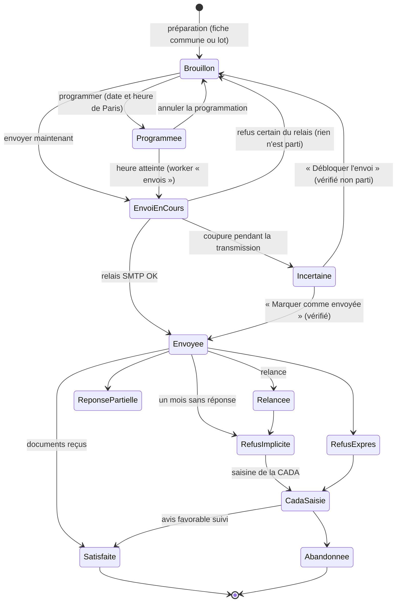
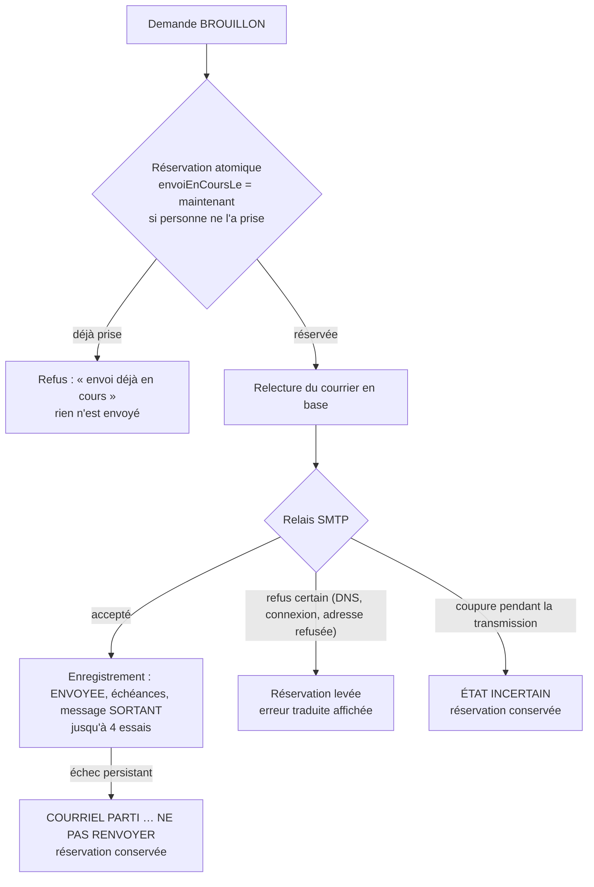

# Demandes CRPA et CADA

Comment la plateforme demande les documents aux mairies, suit les délais légaux et garantit qu'aucune mairie ne reçoit deux fois la même demande.

← [Retour au README](../README.md)

---

## Sommaire

1. [Le cadre légal](#1-le-cadre-légal)
2. [Cycle de vie d'une demande](#2-cycle-de-vie-dune-demande)
3. [Les pièces demandées](#3-les-pièces-demandées)
4. [Le courrier type](#4-le-courrier-type)
5. [Envoyer : maintenant, plus tard, ou en lot](#5-envoyer--maintenant-plus-tard-ou-en-lot)
6. [Garanties : jamais deux envois](#6-garanties--jamais-deux-envois)
7. [Les délais](#7-les-délais)
8. [Relancer](#8-relancer)
9. [Saisir la CADA](#9-saisir-la-cada)
10. [Journal, statuts et affichage public](#10-journal-statuts-et-affichage-public)
11. [Référence technique](#11-référence-technique)

---

## 1. Le cadre légal

| Texte | Ce qu'il dit |
|---|---|
| CRPA, art. **L.300-1** et **L.311-1** | Toute personne a droit à la communication des documents administratifs, sans avoir à justifier d'un intérêt ni d'un motif. |
| CGCT, art. **L.2121-26** | Toute personne peut obtenir les délibérations, budgets et comptes de la commune, et « chacun peut les publier sous sa responsabilité ». |
| CGCT, art. **L.2123-24-1-1** | Chaque commune établit un état annuel des indemnités de ses élus. |
| CRPA, art. **L.311-9** | La communication peut se faire par courrier électronique quand le document existe sous forme électronique. |
| CRPA, art. **R.311-11** | Les frais de reproduction des documents papier peuvent être mis à la charge du demandeur. |
| CRPA, art. **L.311-5**, **L.311-6**, **L.311-7** | Certaines mentions ne sont pas communicables (vie privée, secret des affaires…) ; l'administration les occulte et communique le reste. |
| CRPA, art. **L.311-2** | L'administration n'est pas tenue de répondre aux demandes **abusives**, notamment par leur nombre ou leur caractère répétitif ou systématique (CE, 14/11/2018, n° 420055 : charge disproportionnée). |
| CRPA, art. **R.311-13** | Le silence gardé **plus d'un mois** vaut refus implicite. |
| CRPA, art. **R.343-1** | La CADA doit être saisie dans les **deux mois** qui suivent le refus. |
| CRPA, art. **R.343-5** | Après saisine, le silence de l'administration pendant deux mois à compter de l'enregistrement de la saisine vaut confirmation du refus. |
| CJA, art. **R.421-1** | Le recours au tribunal administratif se forme dans les deux mois. |

D'où les choix de la plateforme : **une seule demande groupée par commune et par an**, une **liste ciblée** pour les grandes communes, et un suivi automatique des délais.

---

## 2. Cycle de vie d'une demande



Statuts enregistrés : `BROUILLON`, `ENVOYEE`, `RELANCEE`, `REFUS_IMPLICITE`, `REFUS_EXPRES`, `CADA_SAISIE`, `REPONSE_PARTIELLE`, `SATISFAITE`, `ABANDONNEE`. « Programmée », « Envoi en cours » et « Sans réponse (refus implicite) » sont des **statuts affichés**, déduits des dates.

Une demande envoyée **ne peut jamais redevenir un brouillon** (ce qui permettrait de la renvoyer).

---

## 3. Les pièces demandées

| Clé | Pièce | Par défaut, moins de 3 500 hab. | Par défaut, 3 500 hab. et plus |
|---|---|:---:|:---:|
| `budget` | Budget primitif et compte administratif (ou compte financier unique), avec annexes | ✔ | |
| `mandats` | État des mandats émis sur les comptes d'investissement (chapitres 20, 21 et 23), extrait du logiciel comptable | | ✔ |
| `indemnites` | État annuel des indemnités des élus (L.2123-24-1-1 CGCT) | ✔ | ✔ |
| `frais` | États de frais et justificatifs des remboursements aux élus | ✔ | ✔ |
| `deliberations` | Délibérations relatives aux travaux, aux marchés et aux finances | ✔ | |
| `travaux` | Devis, bons de commande et factures des travaux et investissements payés | ✔ | |
| `marches` | Marchés publics et accords-cadres en cours, avec leurs pièces contractuelles | ✔ | |
| `subventions` | Décisions d'attribution des subventions perçues | ✔ | ✔ |

**Pourquoi une liste ciblée à partir de 3 500 habitants ?** Ces communes publient en principe en ligne leurs budgets, comptes et délibérations (art. L.2131-1 et L.2313-1 du CGCT), et « toutes les factures de l'année » représenterait des milliers de pièces, avec un risque réel de refus pour demande abusive. L'**état des mandats** donne la liste des dépenses d'investissement : il permet ensuite de cibler les seules opérations significatives. Le courrier précise alors : « Les budgets, comptes et délibérations déjà publiés sur le site internet de la commune ne sont pas demandés. »

Les cases restent modifiables à la création du brouillon. Si la commune a déjà reçu une demande il y a moins de 11 mois, un avertissement rappelle le risque de demande « répétitive ».

---

## 4. Le courrier type

Généré par `courrierDemande()` (`src/lib/demande.ts`), modifiable avant tout envoi :

```text
Objet : Demande de communication de documents administratifs (CRPA) — {Commune}, exercice {année}

Madame, Monsieur le Maire,

Au nom de l'association {Association}, qui publie sur {Plateforme} ({adresse}) les finances des
communes sous une forme lisible par tous, je sollicite, en application des articles L.300-1 et
L.311-1 et suivants du code des relations entre le public et l'administration (CRPA) [et, pour les
délibérations, budgets et comptes, de l'article L.2121-26 du code général des collectivités
territoriales], la communication des documents suivants concernant la commune de {Commune} :

- {pièce 1} ;
- {pièce 2} ;
- …

Conformément à l'article L.311-9 du CRPA, je souhaite recevoir ces documents par courrier
électronique, au format PDF, en réponse à ce message. Si certains n'existent que sur papier, je
vous remercie de me les adresser numérisés si vos moyens le permettent, ou de m'indiquer le coût
de leur reproduction (article R.311-11). Les mentions non communicables au titre des articles
L.311-5 et L.311-6 (vie privée, coordonnées personnelles, données bancaires, secret des
affaires…) sont à occulter avant envoi (article L.311-7) ; nous vérifions en outre chaque
document avant toute publication.

Afin de limiter la charge de vos services, nous n'adressons qu'une demande groupée par commune et
par an.

En l'absence de réponse dans un délai d'un mois, cette demande sera réputée rejetée (article
R.311-13 du CRPA), ce qui ouvrirait la possibilité de saisir la Commission d'accès aux documents
administratifs.

Je vous remercie par avance et vous prie d'agréer, Madame, Monsieur le Maire, l'expression de mes
salutations distinguées.

{Directeur de la publication}
Pour l'association {Association} (RNA {numéro})
{Plateforme} — {adresse}
{courriel}
```

- Le passage sur le CGCT n'apparaît que si des budgets ou délibérations sont demandés.
- Le destinataire est le **courriel de la mairie** (Annuaire, corrigeable dans l'onglet « Informations » de la commune). Corriger ce courriel met à jour les brouillons non envoyés qui utilisaient l'ancienne adresse.

---

## 5. Envoyer : maintenant, plus tard, ou en lot

Tout envoi passe par une **confirmation explicite** : case « J'ai relu le courrier ci-dessus et je confirme l'envoi » (le courrier est affiché juste au-dessus), puis une boîte de dialogue propre au bouton cliqué.

| Mode | Où | Ce qui se passe |
|---|---|---|
| **Maintenant** | Fiche commune → Demandes | Envoi immédiat par le relais SMTP. Le message de succès donne la date limite de réponse. |
| **Programmé** | Fiche commune → Demandes | Date et heure **de Paris** (proposition : prochain jour ouvré à 9 h), au moins 1 minute et au plus 1 an dans le futur. Annulable jusqu'au dernier moment. |
| **En lot** | Département (administration) → « Demandes {année} en lot » | 1) préparer un brouillon pour chaque commune qui a un courriel et pas encore de demande pour l'année ; 2) programmer tous les brouillons non programmés, **étalés** (par défaut 10 par heure) pour ménager le relais et la délivrabilité. |

Options : **copie cachée** à l'adresse de l'association (cochée par défaut), qui sert aussi de preuve d'envoi.

Les envois programmés sont faits par le worker **`envois`**, qui vérifie toutes les **30 secondes** les demandes dont l'heure est atteinte. Cette boucle est indépendante du traitement des documents : une longue analyse ne la retarde jamais.

---

## 6. Garanties : jamais deux envois

Envoyer deux fois la même demande à une mairie nuirait à la crédibilité de l'association. Le code (`src/lib/envoi-demande.ts`) l'empêche dans tous les cas, testés automatiquement (`tests/envoi.test.ts`) :



| Situation | Protection |
|---|---|
| Double clic, deux onglets, deux administrateurs | Réservation atomique (`updateMany … where envoiEnCoursLe is null`) : un seul appel au relais. |
| Envoi programmé + clic « Envoyer maintenant » | Même réservation pour les deux chemins. |
| Deux workers en parallèle | Même réservation ; testé avec trois workers simultanés. |
| Formulaire « Courrier, statut et dates » ouvert avant l'envoi, enregistré après | Refusé : « La demande a changé depuis l'ouverture de cette page. » (contrôle de version sur `majLe`). |
| Courriel parti, base de données injoignable juste après | Message « COURRIEL PARTI … NE PAS RENVOYER » ; boutons « Marquer comme envoyée » ou « Débloquer l'envoi », chacun avec une case « J'ai vérifié… ». |
| Worker arrêté longtemps (panne) | Un envoi programmé avec **plus de 6 heures de retard** n'est pas fait : il est annulé et signalé (« rien n'est parti, vérifiez puis reprogrammez »). |
| Échec du relais | Jamais de nouvel essai automatique : l'erreur, traduite (« relais injoignable », « adresse refusée », « IP non autorisée ? »), est affichée sur le tableau de bord. |

---

## 7. Les délais

Calculés par `delais()` sur la **date calendaire de Paris**, selon la **règle du quantième** : un délai d'un mois expire le même quantième du mois suivant ou, à défaut, le dernier jour de ce mois (art. 641 du code de procédure civile, appliqué par le juge administratif). L'échéance est la fin de cette journée, heure de Paris.

| Envoi | Réponse attendue au plus tard le | CADA à saisir au plus tard le |
|---|---|---|
| 23/11/2026 | 23/12/2026 | 23/02/2027 |
| 31/01/2027 | 28/02/2027 | 28/04/2027 |
| 31/03/2027 | 30/04/2027 | 30/06/2027 |
| 31/01/2028 | 29/02/2028 | 29/04/2028 |

- En cas de **refus exprès**, la limite de saisine de la CADA court à partir de la date de la réponse (obligatoire pour ce statut).
- Après **saisine de la CADA** : refus confirmé deux mois après la saisine sans communication (R.343-5), puis recours au tribunal administratif possible pendant deux mois.

Ces échéances alimentent les alertes du tableau de bord : « Réponse attendue sous 12 jours (au plus tard le …) », « Sans réponse : refus implicite. CADA à saisir au plus tard le … », « Refus confirmé : recours au tribunal administratif possible jusqu'au … ».

---

## 8. Relancer

Pour une demande envoyée et sans réponse, le volet **« Préparer une relance »** propose un texte prérempli (`courrierRelance()`) :

- rappel de la date et de l'objet de la demande initiale ;
- si le délai d'un mois est dépassé, rappel du refus implicite (R.311-13) et de la possibilité de saisir la CADA, sur un ton conciliant ;
- proposition d'une transmission échelonnée ;
- liste des pièces demandées.

La relance part par le même relais, avec confirmation ; **au plus une relance par 24 heures** (réservation atomique). Elle est consignée dans le journal et la demande passe au statut « Relancée ».

---

## 9. Saisir la CADA

Quand la demande est refusée (implicitement ou expressément), le volet **« Saisine de la CADA »** s'ouvre :

- un **texte prêt à copier** (`courrierSaisineCada()`) : rappel de la demande (date, destinataire, pièces), nature du refus, demande d'avis au titre de l'article L.342-1 du CRPA, pièces jointes à fournir ;
- un lien vers [cada.fr](https://www.cada.fr) (formulaire de saisine en ligne) ;
- un formulaire « J'ai saisi la CADA » : date et numéro de dossier. La demande passe en « CADA saisie » et le suivi R.343-5 commence.

---

## 10. Journal, statuts et affichage public

- **Journal des échanges** : chaque envoi et chaque relance faits par la plateforme y sont enregistrés automatiquement (expéditeur, destinataire, objet, texte, identifiant du message). Les réponses des mairies, courriers postaux ou échanges avec la CADA s'y ajoutent à la main.
- **Documents reçus** : les documents déposés peuvent être rattachés à la demande qui les a obtenus.
- **Sur la fiche publique** : la chronologie de chaque demande envoyée (envoi, relance, réponse, saisine, avis, clôture) et le nombre de documents publiés à sa suite. Les brouillons et les notes internes ne sont jamais publiés.

---

## 11. Référence technique

| Élément | Emplacement |
|---|---|
| Pièces, courrier, délais, statuts affichés, relance, saisine | `src/lib/demande.ts` |
| Envoi immédiat et programmé, réservation, erreurs SMTP | `src/lib/envoi-demande.ts` |
| Transport SMTP (TLS 1.2 minimum, pas d'accès aux fichiers ni aux URL) | `src/lib/mail.ts` |
| Actions de l'administration (création, lot, envoi, relance, CADA, déblocage) | `src/app/admin/actions.ts` |
| Boucle d'envoi (30 s) | `scripts/worker.ts`, rôle `envois` |
| Vérification du relais sans envoi | `docker compose exec envois node --import tsx scripts/verifier-smtp.ts` |
| Tests | `tests/envoi.test.ts`, `tests/regles.test.ts` |

Champs principaux du modèle `Demande` : `annee` (une par commune et par an), `objet`, `corps`, `destinataire`, `statut`, `envoiProgrammeLe`, `envoiEnCoursLe` (réservation), `envoiCopieCachee`, `erreurEnvoi`, `envoyeeLe`, `echeanceReponse`, `limiteSaisineCada`, `relanceeLe`, `reponseLe`, `cadaSaisieLe`, `numeroCada`, `avisCadaLe`, `avisCada`, `clotureLe`, `notes` (internes), `majLe` (contrôle de version).
