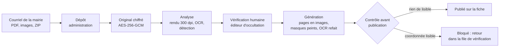
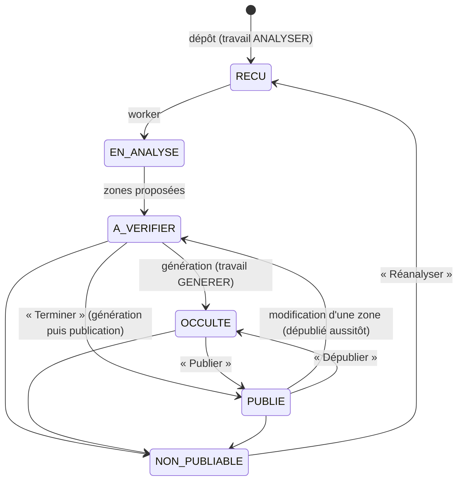

# Documents et occultation

Le parcours d'un document reçu d'une mairie, du dépôt à la publication : chiffrement, analyse automatique, vérification humaine, génération d'une copie sans texte caché, contrôles et conservation.

← [Retour au README](../README.md)

---

## Sommaire

1. [Vue d'ensemble](#1-vue-densemble)
2. [Statuts d'un document](#2-statuts-dun-document)
3. [Dépôt](#3-dépôt)
4. [Analyse automatique](#4-analyse-automatique)
5. [Vérification dans l'éditeur](#5-vérification-dans-léditeur)
6. [Ce qu'on masque, ce qu'on garde](#6-ce-quon-masque-ce-quon-garde)
7. [Génération de la version publique](#7-génération-de-la-version-publique)
8. [Contrôle avant publication](#8-contrôle-avant-publication)
9. [Publication, dépublication, retrait d'urgence](#9-publication-dépublication-retrait-durgence)
10. [Chiffrement et conservation](#10-chiffrement-et-conservation)
11. [Outils en ligne de commande](#11-outils-en-ligne-de-commande)
12. [Référence technique](#12-référence-technique)

---

## 1. Vue d'ensemble



Trois principes :

- **L'original n'est jamais publié** ; il est chiffré dès le dépôt et n'existe en clair que dans un dossier temporaire en mémoire, le temps d'un traitement.
- **Tout ce qui est détecté est une proposition** ; la validation est toujours humaine.
- **La version publique est reconstruite en images** : rien de ce qui est sous un masque ne peut être récupéré (ni texte caché, ni calque, ni annotation).

---

## 2. Statuts d'un document



| Statut | Libellé dans l'administration | Visible du public |
|---|---|---|
| `RECU` | Reçu, en file d'analyse | non |
| `EN_ANALYSE` | Analyse en cours | non |
| `A_VERIFIER` | À vérifier | non |
| `OCCULTE` | Occulté, prêt à publier (ou « Bloqué : coordonnée lisible » si le contrôle a échoué) | non |
| `PUBLIE` | Publié | **oui** |
| `NON_PUBLIABLE` | Non publiable | non |

Le champ `travail` (`ANALYSER` ou `GENERER`) indique ce que le worker doit faire ; `revision` est incrémenté à chaque modification qui rend la version publique obsolète (voir [section 7](#7-génération-de-la-version-publique)).

---

## 3. Dépôt

**Où** : administration → « Déposer », ou bouton « Déposer des documents » sur la fiche d'une commune (commune présélectionnée).

| Format | Traitement |
|---|---|
| PDF | Importé tel quel. |
| Images (JPEG, PNG, TIFF, WebP) | Redressées selon l'EXIF, aplaties sur fond blanc, converties en PDF (60 mégapixels au plus). |
| Archives ZIP | Décompressées **en mémoire** (rien en clair sur le disque) ; chaque fichier est importé ; un niveau d'archive imbriquée est accepté. |

Le type est reconnu par le **contenu** du fichier (signature binaire), pas par son extension : un fichier HTML ou SVG déguisé est ignoré.

**Limites** : 100 Mo par envoi et par fichier, 600 Mo décompressés et 1 000 fichiers par archive (protection contre les « bombes zip »), entrées à chemin suspect (`../`) refusées.

À l'entrée, chaque document est :

1. **chiffré** (voir [section 10](#10-chiffrement-et-conservation)) ;
2. **dédoublonné** : empreinte SHA-256 de l'original, unique par commune ;
3. **classé** : catégorie déduite du nom du dossier ou du fichier (facture, devis, délibération, budget…), titre nettoyé (« COLAS - FAC… - Mandat n°110 » → « COLAS, mandat n°110 »), année si elle figure dans le nom ;
4. **rattaché à un lot** (nom du dossier ou de l'archive) ;
5. **mis en file d'analyse**. Rien n'est publié automatiquement.

L'écran de dépôt affiche la progression par fichier, le résultat (importé, doublon, ignoré, erreur) et un lien direct vers chaque document importé. Un fichier ajouté par erreur peut être retiré avant l'envoi.

---

## 4. Analyse automatique

Faite par le worker **`documents`** (sans accès à Internet), page par page :

1. **Rendu** de la page en image à **300 dpi** (`pdftoppm`), avec vérification que le rendu est complet.
2. **OCR** en français (`tesseract`, sortie TSV : chaque mot et sa position).
3. **Détection** des mentions à masquer, proposées comme zones « à vérifier » :

| Règle | Motif proposé | Détail |
|---|---|---|
| IBAN | Données bancaires | Clé de contrôle valide, ou mot « IBAN / RIB / BIC / banque / domiciliation » sur la ligne ; 15 caractères au moins (les n° de TVA, publics, sont écartés). |
| BIC / SWIFT | Données bancaires | Après la mention « BIC » ou « SWIFT ». |
| RIB | Données bancaires | Banque (5) guichet (5) compte (11) clé (2). |
| Téléphones | Coordonnées personnelles | Formats français, `+33` compris ; **le numéro de la mairie est exclu**. |
| Adresses électroniques | Coordonnées personnelles | **L'adresse de la mairie est exclue.** |
| Signatures et tampons | Signature | Analyse d'image sans OCR : un trait de signature est une grande composante d'encre clairsemée, un tampon un anneau ; filets de tableau et en-têtes écartés. |

4. **Aperçu** de la page (ramené à 200 dpi, JPEG), **chiffré**, pour l'éditeur.

**Limites de sécurité** : 500 pages au plus par document, pages plus grandes que l'A0 refusées, 3 minutes au plus par outil et par page (au-delà, l'outil est arrêté), abandon après 3 échecs successifs avec un message dans l'administration. Une nouvelle analyse conserve les zones déjà validées ou tracées à la main.

Durée indicative : une dizaine de secondes par page.

---

## 5. Vérification dans l'éditeur

**Où** : administration → Documents → un document « À vérifier » (ou le lien du tableau de bord). L'éditeur enchaîne les documents de la file : « Document 3 sur 12 à vérifier », Précédent / Suivant.

```text
┌───────────────────────────────────────────────┬────────────────────────────────┐
│ ← Précédent   Document 3 sur 12   Suivant →   │ [À vérifier]   4 zones · 2 à   │
│ Titre du document                             │ vérifier                       │
│ [−] 100 % [+]  Ctrl + molette, Espace + glisser│ [Terminer et passer au suivant]│
│ ┌───────────────────────────────────────────┐ │ Motif des nouvelles zones ▾    │
│ │ Page 1 / 2                                │ │ ☐ Voir sous les masques        │
│ │   ███████  ← zone validée (noire)         │ │ Reprendre les zones de… ▾      │
│ │   ┅┅┅┅┅┅┅  ← zone proposée (à vérifier)   │ │ Zone sélectionnée : motif,     │
│ │   tracez un rectangle pour masquer        │ │ Valider / Supprimer            │
│ └───────────────────────────────────────────┘ │ Informations : titre, catégorie│
│                                               │ date, entreprise, montants,    │
│                                               │ chantier, second exemplaire    │
└───────────────────────────────────────────────┴────────────────────────────────┘
```

### Raccourcis clavier

| Touche | Action |
|---|---|
| <kbd>Tab</kbd> / <kbd>Maj</kbd>+<kbd>Tab</kbd> | Zone à vérifier suivante / précédente (dans l'ordre de lecture : page, ligne, gauche à droite). |
| <kbd>Entrée</kbd> | Valider la zone sélectionnée, puis passer à la suivante. |
| <kbd>Suppr</kbd> | Supprimer la zone sélectionnée, puis passer à la suivante (Retour arrière ne supprime **pas**, pour éviter les erreurs). |
| <kbd>Ctrl</kbd>+<kbd>Z</kbd> | Rétablir la dernière zone supprimée (même emplacement, même motif). |
| <kbd>Échap</kbd> | Désélectionner. |
| <kbd>Ctrl</kbd>+<kbd>Entrée</kbd> | **Terminer** : valider toutes les zones, générer, publier, puis ouvrir le document suivant. |
| <kbd>+</kbd> / <kbd>−</kbd> / <kbd>0</kbd>, <kbd>Ctrl</kbd>+molette | Zoomer, dézoomer, revenir à la largeur (le zoom garde le point visé immobile). |
| <kbd>Espace</kbd> + glisser | Se déplacer dans la page zoomée. |

### Bon à savoir

- **Tracer** une zone : un rectangle à la souris sur la page ; **ajuster** : glisser la zone ou ses coins.
- Chaque zone indique sa **position** (« page 1, en haut à droite ») pour savoir laquelle on supprime.
- **Voir sous les masques** rend les zones transparentes pour relire ce qu'elles couvrent.
- **Reprendre les zones manuelles de…** copie les zones tracées sur un document au même modèle (bons de commande, délibérations) ; elles arrivent comme propositions à vérifier.
- **Informations** : titre public, catégorie, année, date, entreprise, objet, montants TTC et HT, chantier, « second exemplaire ». Elles sont **enregistrées automatiquement** quand on change de document (« Terminer », Précédent, Suivant) ; une saisie de montant illisible est refusée avec un message.
- **Corriger une erreur de dépôt** : déplacer le document vers une autre commune (code INSEE) ou le supprimer définitivement s'il n'est pas publié.
- Après « Terminer », l'éditeur **surveille le document précédent** : s'il est bloqué par le contrôle avant publication, une alerte s'affiche avec un lien.

---

## 6. Ce qu'on masque, ce qu'on garde

| On masque | Motif |
|---|---|
| Adresses, téléphones et courriels **personnels** | Coordonnées personnelles |
| Pour un **entrepreneur individuel** : numéro et voie de l'adresse (souvent son domicile), téléphones, courriels | Coordonnées personnelles |
| IBAN, RIB, BIC | Données bancaires |
| Signatures, paraphes, tampons nominatifs, et la **mention manuscrite d'identité** qui accompagne une signature | Signature |
| Numéro de sécurité sociale, situation familiale, santé, toute mention de vie privée | Vie privée |
| Appréciation ou jugement de valeur sur une personne physique | Appréciation sur une personne |
| Mention relevant du secret des affaires, **sur demande fondée** d'une entreprise | Secret des affaires |

| On garde | Pourquoi |
|---|---|
| Dénomination des entreprises et leur commune | Nécessaire pour comprendre qui a été payé. |
| Montants, quantités, désignations des devis acceptés, bons de commande et factures des entreprises **retenues** | Ils justifient une dépense publique engagée. Les offres non retenues ne sont jamais publiées. |
| Nom des élus dans les délibérations | Les délibérations sont des documents publics (art. L.2121-26 CGCT) ; elles sont reproduites telles quelles. |
| Coordonnées de la mairie | Publiques (Annuaire de l'administration). |
| Nom et fonction d'un agent signataire d'un acte | Il agit dans l'exercice de ses fonctions. |

Les indemnités et frais des élus sont présentés **par fonction** sur la fiche (pas par nom).

---

## 7. Génération de la version publique

Déclenchée par « Générer la version occultée » ou par « Terminer ». Le worker `documents` :

1. vérifie que toutes les zones sont validées ;
2. rend chaque page à **200 dpi** et **peint en noir** les zones validées dans l'image ;
3. compresse chaque page en JPEG (qualité 72) ;
4. assemble le PDF avec `tesseract`, qui ajoute une couche de texte invisible **issue de l'image déjà occultée** (le PDF reste cherchable, sans rien révéler) ;
5. ajoute en bas de chaque page : « Copie occultée publiée par Le Petit Grand Livre (association Antaria Systems) le {date}, à partir d'un document communiqué par la mairie de {commune}. Ne vaut pas original. » ;
6. nettoie les métadonnées (auteur vide, producteur et créateur « Le Petit Grand Livre », sujet neutre) ;
7. lance le **contrôle avant publication** (section suivante) ;
8. écrit un **nouveau fichier** (`publics/{id}-r{révision}-….pdf`), puis bascule la base dessus ; l'ancien fichier est supprimé après la bascule.

**Révision et course édition / génération.** Chaque modification d'une zone, « Dépublier », « Non publiable », « Réanalyser », « Terminer » incrémente la révision du document. Le worker mémorise la révision au début de la génération et n'enregistre le résultat que si elle n'a pas changé : une zone ajoutée pendant la génération entraîne l'abandon de cette version (le document reste « À vérifier »), et un document marqué « Non publiable » ne peut jamais être republié par une génération en cours.

---

## 8. Contrôle avant publication

Le texte de la version publique (sa couche OCR) est relu avant toute publication automatique :

| Recherché | Bloque la publication | Exception |
|---|---|---|
| Adresse électronique nominative | oui | adresses génériques (contact@, mairie@, comptabilite@…) et adresse de la mairie |
| IBAN (clé valide) | oui | — |
| RIB (clé valide) | oui | — |
| N° de sécurité sociale (clé valide, Corse comprise) | oui | — |
| Téléphone mobile (06, 07, +33 6/7) | oui | numéro de la mairie |
| Téléphone fixe | non | trié à la main |

Si quelque chose reste lisible, le document **n'est pas publié** : il reste « Occulté » avec le message « Bloqué par le contrôle avant publication : encore lisible → IBAN FR76***89 … ». Les valeurs sont **masquées** dans le message (jamais enregistrées en clair). Le document revient dans la file de vérification et apparaît sur le tableau de bord (« Bloqués par le contrôle »). S'il s'agit d'une coordonnée publique, il peut être publié manuellement.

---

## 9. Publication, dépublication, retrait d'urgence

- **Terminer** publie automatiquement après la génération, sauf blocage.
- **Publier** (statut « Occulté ») met en ligne la version déjà générée.
- **Dépublier** retire le document du site immédiatement.
- **Toute modification de zone** sur un document publié le **dépublie aussitôt** (la version en ligne pourrait montrer ce qu'on vient de masquer) ; « Terminer » le republie.
- **Non publiable** : le document est conservé mais ne sera jamais publié.
- La vue « Publiés aujourd'hui » (Documents) permet de relire d'un coup d'œil les publications automatiques du jour.

Le PDF public est servi par `/documents/{id}` uniquement si le statut est `PUBLIE` (sinon 404), avec `Cache-Control: public, no-cache` et un `ETag` : le navigateur revalide à chaque ouverture, donc un retrait est **immédiat**. Les plages d'octets (reprise de téléchargement) sont gérées.

**Retrait d'urgence** (une donnée a échappé à l'occultation) :

1. « Dépublier » dans l'éditeur (ou ajouter la zone manquante, ce qui dépublie aussi) ;
2. si une règle de cache a été ajoutée chez Cloudflare : purger l'URL `/documents/{id}` ;
3. si le document a été indexé : demande de suppression dans la Search Console ;
4. pour un texte resté lisible dans plusieurs documents d'une commune : `scripts/masquer-texte.ts` (section 11).

---

## 10. Chiffrement et conservation

- **Originaux et aperçus** : chiffrés en **AES-256-GCM** (format `ODC1 | IV 12 octets | tag 16 octets | données`, IV aléatoire par fichier, tag vérifié), avec la clé `ORIGINALS_KEY` (64 caractères hexadécimaux), qui n'est jamais en base ni dans les journaux. **Sans cette clé, les originaux sont perdus** : elle doit être sauvegardée hors du serveur.
- **Fichiers temporaires** : les traitements déchiffrent dans un dossier temporaire en mémoire (tmpfs), supprimé quoi qu'il arrive à la fin.
- **Versions publiques** : en clair (elles sont publiques), dans `publics/`.
- **Durée de conservation** : les originaux et aperçus sont **supprimés automatiquement cinq ans après la publication** (purge quotidienne du worker `documents`) ; seule la version publique subsiste.

| Dossier du stockage | Contenu | Chiffré |
|---|---|---|
| `originaux/{id}.bin` | Original reçu | oui |
| `apercus/{id}/{page}.bin` | Aperçus des pages pour l'éditeur | oui |
| `publics/{id}-….pdf` | Version occultée publiée | non |

---

## 11. Outils en ligne de commande

À lancer dans le conteneur `tools` : `docker compose run --rm tools npx tsx scripts/<script>.ts …`

| Script | Usage |
|---|---|
| `import-documents.ts --commune 11199 --dossier /import --lot "Nom"` | Import d'un gros lot (dossier monté en lecture seule). Pour un dépôt courant, l'administration suffit. |
| `masquer-texte.ts --commune 11199 --motif "regex" [--motif-occultation COORDONNEES_PERSO] [--confirmer]` | Retrouve un texte resté lisible dans les versions publiques d'une commune, ajoute une zone exactement dessus, régénère et republie. Sans `--confirmer` : liste seulement. |
| `supprimer-lot.ts --lot "Nom" [--confirmer]` | Supprime définitivement tous les documents d'un lot (base, original, aperçus, version publique). Refusé si un document du lot est publié. |
| `detecter-signatures.ts [--confirmer]` | Ajoute des propositions de signatures aux documents encore à vérifier, sans toucher aux zones existantes. |
| `evaluer-signatures.ts [contraste] [--visu]` | Mesure la qualité du détecteur de signatures contre les zones tracées à la main. |
| `appliquer-donnees.ts donnees/{commune}.json [--confirmer]` | Applique un relevé (chantiers, informations par document) ; idempotent. |

---

## 12. Référence technique

| Élément | Emplacement |
|---|---|
| Import (formats, limites, classement, chiffrement) | `src/lib/import-documents.ts`, route `src/app/api/depot/route.ts` |
| Analyse et génération, contrôle avant publication | `src/lib/traitement/pipeline.ts` |
| Règles de détection, clés IBAN / RIB / NIR | `src/lib/traitement/detection.ts` |
| Détection des signatures | `src/lib/traitement/signatures.ts` |
| Outils externes (délais maximaux) | `src/lib/traitement/outils.ts` |
| Stockage et chiffrement | `src/lib/stockage.ts` |
| Purge des originaux | `src/lib/conservation.ts` |
| Éditeur | `src/components/admin/EditeurOccultation.tsx` |
| API de l'éditeur | `src/app/api/admin/documents/[id]/…`, `src/app/api/admin/zones/[zoneId]` |
| Invalidation (révision, dépublication) | `src/lib/admin-documents.ts` |
| Service public des PDF | `src/app/documents/[id]/route.ts` |
| Worker | `scripts/worker.ts`, rôle `documents` |
