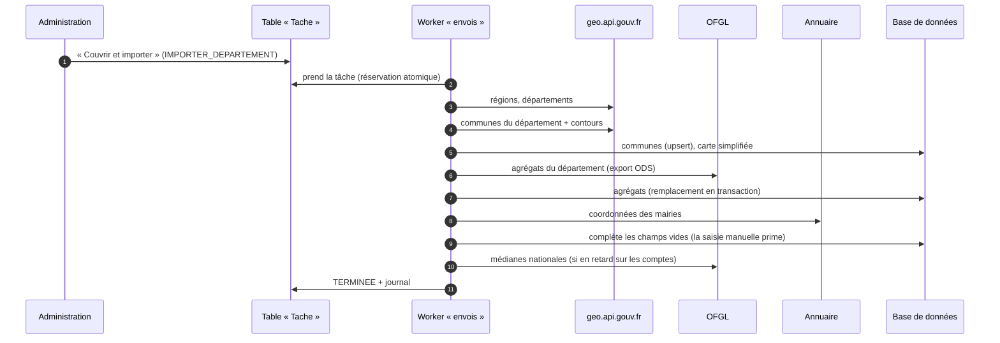

# Données financières

D'où viennent les chiffres des fiches, comment ils sont importés, calculés et comparés, et comment les réutiliser.

← [Retour au README](../README.md)

---

## Sommaire

1. [Sources](#1-sources)
2. [Import d'un département](#2-import-dun-département)
3. [Les agrégats utilisés](#3-les-agrégats-utilisés)
4. [Montants par habitant et communes nouvelles](#4-montants-par-habitant-et-communes-nouvelles)
5. [Médianes de comparaison](#5-médianes-de-comparaison)
6. [Garde-fous de l'import](#6-garde-fous-de-limport)
7. [Phrases générées et arrondis](#7-phrases-générées-et-arrondis)
8. [Export CSV](#8-export-csv)
9. [Chantiers et montants relevés sur les documents](#9-chantiers-et-montants-relevés-sur-les-documents)
10. [Limites connues](#10-limites-connues)

---

## 1. Sources

| Source | Jeu de données | Utilisé pour | Licence |
|---|---|---|---|
| **OFGL** — Observatoire des finances et de la gestion publique locales ([data.ofgl.fr](https://data.ofgl.fr)) | `ofgl-base-communes` | Agrégats comptables par commune, exercice et type de budget, depuis 2018 ; strate de population ; intercommunalité ; population totale. | Licence Ouverte 2.0 |
| **geo.api.gouv.fr** (API Découpage administratif, d'après l'Insee et l'IGN) | `/regions`, `/departements`, `/departements/{code}/communes` | Régions, départements, communes, populations municipales, codes postaux, SIREN, contours pour la carte de situation. | Licence Ouverte 2.0 |
| **Annuaire de l'administration** ([api-lannuaire.service-public.fr](https://api-lannuaire.service-public.fr)) | `api-lannuaire-administration` (pivot « mairie ») | Adresse, téléphone, courriel et site des mairies (destinataire des demandes). | Licence Ouverte 2.0 |

Les données de l'OFGL proviennent des balances comptables des communes tenues par la **DGFiP**. L'OFGL les agrège selon une nomenclature commune à toutes les collectivités, ce qui rend les comparaisons possibles.

---

## 2. Import d'un département



Deux façons de lancer un import :

- **Depuis l'administration** : Territoires → région → « Couvrir et importer » sur la ligne du département. Le worker `envois` exécute la tâche ; son journal est visible sur le tableau de bord. Une tâche interrompue par un redémarrage est marquée « erreur » et peut être relancée.
- **En ligne de commande**, pour tous les départements de `DEPARTEMENTS_ACTIFS` et ceux activés en base :

  ```sh
  docker compose run --rm tools npm run import:all     # import:geo, puis import:ofgl, puis import:annuaire
  ```

Étapes et règles :

| Étape | Fonction | Règle |
|---|---|---|
| Référentiel | `importerReferentiel` | Régions et départements mis à jour ; un département activé n'est jamais désactivé par un import. |
| Communes | `importerCommunes` | Upsert par code INSEE ; nom normalisé pour la recherche ; `slug` = nom + code INSEE (plusieurs Lavalette existent). |
| Carte | `projeterDepartement` | Contours projetés dans un cadre propre au département et simplifiés (Douglas-Peucker sur anneaux fermés) ; fond servi en SVG mis en cache (`/cartes/{code}.svg`). |
| Comptes | `importerFinances` | Voir sections 3 à 6. |
| Mairies | `importerAnnuaire` | Seuls les champs vides sont complétés : une adresse corrigée à la main dans l'administration n'est jamais écrasée. Seuls les sites en `http(s)://` sont repris. |
| Médianes | `importerReferencesStrates` | Rafraîchies quand elles sont absentes ou en retard d'un exercice sur les comptes importés. |

La date du dernier import réussi est enregistrée (table `Etat`, clé `import:finances:{département}`) et affichée sur les fiches et dans le CSV : c'est la « date de dernière mise à jour » exigée par l'article L.322-1 du CRPA et la Licence Ouverte.

---

## 3. Les agrégats utilisés

Libellés exacts de l'OFGL (`src/lib/finances.ts`) :

| Clé dans le code | Agrégat OFGL | Où il apparaît |
|---|---|---|
| `depensesTotales` | Dépenses totales hors remb | L'essentiel, comparaison |
| `recettesTotales` | Recettes totales hors emprunts | Comparaison |
| `recettesFonct` | Recettes de fonctionnement | Budget (« D'où vient l'argent », courbes) |
| `depensesFonct` | Dépenses de fonctionnement | Budget (« Où va l'argent », courbes) |
| `epargneBrute` | Epargne brute | L'essentiel, capacité de désendettement |
| `epargneNette` | Epargne nette | Comparaison |
| `encoursDette` | Encours de dette | L'essentiel, dette par habitant |
| `annuiteDette` | Annuité de la dette | Comparaison |
| `depensesEquipement` | Dépenses d'équipement | L'essentiel, investissement |
| `depensesInvest` | Dépenses d'investissement hors remb | Comparaison |
| `personnel` | Frais de personnel | « Où va l'argent » |
| `achats` | Achats et charges externes | « Où va l'argent » |
| `intervention` | Dépenses d'intervention | « Où va l'argent » (subventions et participations versées) |
| `chargesFinancieres` | Charges financières | « Où va l'argent » (intérêts de la dette) |
| `autresDepFonct` | Autres dépenses de fonctionnement | « Où va l'argent » |
| `impotsLocaux` | Impôts locaux | « D'où vient l'argent » |
| `dgf` | Dotation globale de fonctionnement | « D'où vient l'argent » (dotations de l'État) |
| `subventionsRecues` | Autres dotations et subventions | « D'où vient l'argent » |
| `fiscaliteReversee` | Fiscalité reversée | « D'où vient l'argent » |

Les graphiques de la fiche portent sur le **budget principal** (`typeBudget = "Budget principal"`). Les budgets annexes d'une commune sont importés, cumulés par agrégat (`"Budget annexe"`), et disponibles dans le CSV.

**Capacité de désendettement** = encours de dette ÷ épargne brute (en années), calculée seulement si l'épargne brute est positive.

---

## 4. Montants par habitant et communes nouvelles

Pour une commune ordinaire, l'OFGL publie une ligne par agrégat, exercice et budget, avec le montant et le montant par habitant (`euros_par_habitant`) : la plateforme reprend tels quels ces deux nombres.

**Communes nouvelles.** Quand plusieurs communes ont fusionné, l'OFGL peut publier **plusieurs lignes « Budget principal »** pour le même code et le même exercice (une par commune historique, chacune avec sa population). Additionner les euros par habitant serait faux : des euros par habitant calculés sur des populations différentes ne s'additionnent pas. La plateforme :

1. additionne les **montants** ;
2. additionne les **populations** (`ptot`) des budgets principaux ;
3. recalcule **euros par habitant = Σ montants ÷ Σ populations**.

Pour les budgets annexes, la population est la même sur chaque ligne : elle n'est comptée qu'une fois.

> Exemple : Val-de-Dagne (11251), exercice 2018, dépenses totales : 873 433 € pour 538 + 184 = 722 habitants, soit **1 210 €/hab.** (et non 2 485 €/hab. en additionnant les euros par habitant de chaque ligne).

**Deux populations, deux usages** :

| Population | Source | Usage |
|---|---|---|
| Municipale | geo.api.gouv.fr (Insee) | Affichée dans l'en-tête de la fiche (« 1 612 hab. ») ; seuil de 3 500 habitants des demandes. |
| Totale | OFGL (`ptot`, dernier exercice) | Montants par habitant ; **barème légal des indemnités des élus**, qui se réfère à la population totale. |

---

## 5. Médianes de comparaison

Les médianes sont calculées par l'API de l'OFGL sur **toutes les communes de France**, par exercice, strate et agrégat, sur le budget principal :

```text
select   exer, tranche_population, agregat,
         median(euros_par_habitant), avg(euros_par_habitant), count(*)
where    type_de_budget = 'Budget principal' and euros_par_habitant is not null
group by exer, tranche_population, agregat
```

- La **strate** d'une commune est la `tranche_population` de l'OFGL pour son dernier exercice (11 strates, de « moins de 100 habitants » à « 100 000 habitants et plus »).
- L'**écart** affiché est `(valeur − médiane) ÷ médiane`.
- Le calcul de médiane de l'API est une approximation (écart mesuré de l'ordre de 0,03 % par rapport à un calcul exact sur 11 212 communes), sans effet à l'affichage.

---

## 6. Garde-fous de l'import

- **Remplacement atomique** : les agrégats d'un département sont supprimés puis recréés **dans une même transaction**. Une erreur en cours de route ne laisse jamais une fiche vide.
- **Réponse tronquée** : si l'OFGL renvoie moins de la moitié des lignes déjà en base (panne, réponse vide), l'import est **annulé** sans rien modifier, avec un message explicite. Même règle pour les médianes.
- **Tâches** : une tâche d'import est réservée de façon atomique ; une tâche « en cours » au démarrage du worker (redémarrage brutal) est marquée en erreur pour pouvoir être relancée.

---

## 7. Phrases générées et arrondis

Le bloc « L'essentiel » est rédigé automatiquement (`src/lib/resume.ts`) :

- montants compacts : `873 k€`, `1,3 M€` (au-delà de 10 000 €) ;
- comparaison : « proche de la médiane » si l'écart est faible, sinon « 24 % de moins / de plus que la médiane des communes de 500 à 1 999 habitants » ;
- dette : « La dette de son budget principal s'élève à … ; il faudrait 1,9 année d'épargne brute pour la rembourser entièrement » (singulier sous 2) ;
- les espaces fines des nombres sont remplacées par des espaces insécables, plus lisibles à petite taille.

---

## 8. Export CSV

Chaque fiche propose **« Télécharger les données (CSV) »** : `/communes/{slug}/donnees.csv`.

- Encodage UTF-8 avec BOM (ouverture directe dans un tableur), séparateur `;`.
- Une ligne par exercice, type de budget et agrégat.

| Colonne | Exemple | Remarque |
|---|---|---|
| `code_insee` | `11199` | |
| `commune` | `Lavalette` | |
| `exercice` | `2025` | |
| `type_budget` | `Budget principal` | ou `Budgets annexes (cumulés)` |
| `agregat` | `Encours de dette` | libellé OFGL |
| `montant_euros` | `694500.12` | deux décimales, point décimal |
| `euros_par_habitant` | `430.56` | vide si non disponible |
| `source` | `OFGL (data.ofgl.fr), comptes DGFiP` | |
| `licence` | `Licence Ouverte 2.0` | |
| `mise_a_jour` | `2026-11-21` | date du dernier import |

Réutilisation libre (Licence Ouverte 2.0) en mentionnant la source (« Le Petit Grand Livre, d'après l'OFGL ») et la date de mise à jour.

---

## 9. Chantiers et montants relevés sur les documents

Les montants de la section « Travaux et marchés » ne viennent pas de l'OFGL mais des **documents reçus** :

- chaque document porte, s'il y a lieu : entreprise, objet, montant TTC (facture : net payé), montant HT, date, chantier, et une case « second exemplaire » (exclu des totaux) ;
- ces informations sont saisies dans l'éditeur (voir [documents-occultation.md](documents-occultation.md)) ou appliquées en lot depuis un fichier JSON relevé à la main (`scripts/appliquer-donnees.ts`, exemple : `donnees/11199-lavalette.json`) ;
- un chantier (`Operation`) regroupe ses pièces ; son montant **facturé** est la somme des factures, hors seconds exemplaires ; son montant **voté ou commandé** est saisi d'après la délibération ou les bons de commande.

Saisie des montants dans l'administration : « 1 234,56 », « 1.234,56 », « 1234.56 » et « 2 640,00 € » sont tous compris ; une saisie illisible est **refusée avec un message**, jamais enregistrée à vide.

---

## 10. Limites connues

- Les comptes d'un exercice sont publiés par l'OFGL avec un décalage (l'exercice N est généralement disponible au cours de l'année N+1).
- Les budgets annexes sont cumulés et ne figurent pas dans les graphiques.
- Les communes nouvelles récentes peuvent avoir des séries interrompues avant la fusion.
- Les montants issus des documents dépendent de la complétude de la réponse de la mairie.
