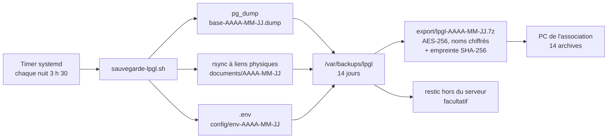
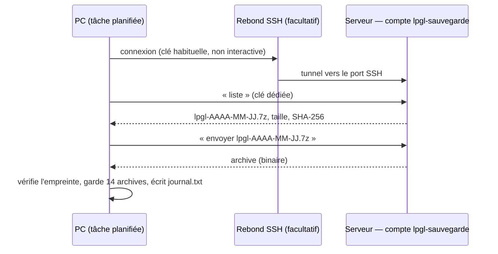

# Exploitation

Faire vivre la plateforme en production : déployer et revenir en arrière, sauvegarder et restaurer, surveiller, réagir aux incidents.

← [Retour au README](../README.md)

---

## Sommaire

1. [Commandes courantes](#1-commandes-courantes)
2. [Déployer une nouvelle version](#2-déployer-une-nouvelle-version)
3. [Revenir à une version précédente](#3-revenir-à-une-version-précédente)
4. [Sauvegardes](#4-sauvegardes)
5. [Copie sur un PC Windows](#5-copie-sur-un-pc-windows)
6. [Restaurer](#6-restaurer)
7. [Supervision](#7-supervision)
8. [Incidents courants](#incidents-courants)
9. [Opérations ponctuelles](#9-opérations-ponctuelles)
10. [Calendrier d'entretien](#10-calendrier-dentretien)

---

## 1. Commandes courantes

```sh
docker compose ps                                   # état et santé des services
docker compose logs -f --tail 50 app                # journaux du site
docker compose logs -f --tail 50 worker             # analyse des documents
docker compose logs -f --tail 50 envois             # envois programmés, imports
docker compose exec envois node --import tsx scripts/verifier-smtp.ts   # relais SMTP, sans envoi
docker compose run --rm tools npx prisma migrate status                 # migrations appliquées ?
docker system df && df -h /                          # espace disque
```

Les journaux de chaque service sont limités à 3 fichiers de 10 Mo.

---

## 2. Déployer une nouvelle version

```sh
git pull
scripts/exploitation/deployer.sh
```

Le script :

1. construit les images `app`, `worker`, `tools` ;
2. les **étiquette avec le commit** (`opendata-communes-app:<commit>`…) pour pouvoir y revenir ;
3. applique les migrations (`prisma migrate deploy`, avec le propriétaire de la base) ;
4. redémarre `app`, `worker` et `envois` ;
5. vérifie que le site répond.

Points d'attention :

- **Envois programmés** : redémarrer `envois` pendant un envoi est sans danger (réservation atomique, état incertain signalé), mais évitez de déployer à l'heure d'un envoi programmé en lot.
- **Sessions** : un changement de `AUTH_SECRET` déconnecte tous les administrateurs.
- **Mémoire** : la construction de l'image du site consomme beaucoup de mémoire ; sur un petit serveur, ne lancez pas d'autres tâches lourdes en même temps.
- Une modification du seul `.env` ne demande pas de reconstruction : `docker compose up -d app worker envois`.

---

## 3. Revenir à une version précédente

```sh
docker images | grep opendata-communes-app            # étiquettes disponibles
scripts/exploitation/deployer.sh <étiquette>           # remet ces images en service
```

Les migrations ne sont **pas** annulées : un retour arrière n'est sûr que si la version visée est compatible avec le schéma actuel (c'est le cas quand la migration ne fait qu'ajouter des colonnes ou des tables). En cas de doute, restaurer aussi la base (section 6).

---

## 4. Sauvegardes



| Élément | Emplacement |
|---|---|
| Script | `/usr/local/sbin/sauvegarde-lpgl.sh` (copie de `scripts/exploitation/sauvegarde.sh`) |
| Planification | `sauvegarde-lpgl.timer` → `sauvegarde-lpgl.service` (3 h 30, rattrapé si le serveur était éteint) |
| Copies locales | `/var/backups/lpgl/{base,documents,config}`, 14 jours ; les instantanés de documents ne stockent que les fichiers nouveaux |
| Export chiffré | `/var/backups/lpgl/export/lpgl-AAAA-MM-JJ.7z` (deux derniers), mot de passe dans `/root/.lpgl-export-motdepasse` |

Installation (une fois, en root) :

```sh
install -m 700 scripts/exploitation/sauvegarde.sh /usr/local/sbin/sauvegarde-lpgl.sh
install -m 644 scripts/exploitation/sauvegarde-lpgl.service scripts/exploitation/sauvegarde-lpgl.timer /etc/systemd/system/
apt install -y rsync p7zip-full
(umask 077; openssl rand -base64 33 | tr -d '\n=' > /root/.lpgl-export-motdepasse)   # à copier dans un gestionnaire de mots de passe
systemctl daemon-reload && systemctl enable --now sauvegarde-lpgl.timer
systemctl start sauvegarde-lpgl.service && journalctl -u sauvegarde-lpgl -n 5
```

**Copie hors du serveur avec restic** (conseillée, en plus du PC) : installer restic, créer un dépôt (Storage Box, S3 d'un autre fournisseur), puis écrire `/root/.lpgl-sauvegarde.env` (mode 600) :

```sh
RESTIC_REPOSITORY=sftp:utilisateur@stockage.exemple.fr:/lpgl
RESTIC_PASSWORD_FILE=/root/.lpgl-restic-motdepasse
```

Le script l'utilise alors automatiquement (rétention : 7 quotidiennes, 4 hebdomadaires, 12 mensuelles).

> **À conserver hors du serveur**, dans un gestionnaire de mots de passe : `ORIGINALS_KEY`, le mot de passe des archives, le mot de passe de restic. Sans `ORIGINALS_KEY`, une sauvegarde des originaux est inutilisable.

---

## 5. Copie sur un PC Windows

Le PC de l'association télécharge chaque jour l'archive chiffrée par SSH, avec une clé qui **ne peut rien faire d'autre**.



**Sur le serveur** (en root, une fois), avec la clé publique affichée par l'installateur Windows :

```sh
install -m 755 scripts/exploitation/lpgl-export.sh /usr/local/sbin/lpgl-export
useradd --system --create-home --home-dir /var/lib/lpgl-sauvegarde --shell /bin/sh lpgl-sauvegarde
passwd -l lpgl-sauvegarde                                    # aucune connexion par mot de passe
install -d -m 700 -o lpgl-sauvegarde -g lpgl-sauvegarde /var/lib/lpgl-sauvegarde/.ssh
echo 'restrict,command="/usr/local/sbin/lpgl-export" <CLÉ PUBLIQUE DU PC>' > /var/lib/lpgl-sauvegarde/.ssh/authorized_keys
chown lpgl-sauvegarde:lpgl-sauvegarde /var/lib/lpgl-sauvegarde/.ssh/authorized_keys
chmod 600 /var/lib/lpgl-sauvegarde/.ssh/authorized_keys
chmod 711 /var/backups/lpgl
systemctl start sauvegarde-lpgl.service                     # régénère l'archive avec les bons droits
```

La commande forcée `lpgl-export` n'accepte que `liste` et `envoyer <nom de l'archive>` ; `restrict` interdit terminal, redirections et transferts.

**Sur le PC** (PowerShell, sans droits administrateur), avec les deux fichiers de `scripts/exploitation/windows/` :

```powershell
powershell -ExecutionPolicy Bypass -File Installer-Sauvegarde-LPGL.ps1 -Serveur lpgl-sauvegarde@<adresse du serveur> [-Rebond <utilisateur>@<rebond>]
```

- Crée la clé `%USERPROFILE%\.ssh\lpgl_sauvegarde` (si absente) et affiche la clé publique.
- Enregistre la tâche **« Sauvegarde LPGL »** : toutes les heures de 8 h à 23 h ; elle ne télécharge qu'une archive par jour.
- Archives dans `Documents\Sauvegardes LPGL`, journal dans `journal.txt`.
- Si la clé utilisée pour le rebond a une phrase de passe : activer l'agent SSH de Windows (PowerShell administrateur : `Set-Service ssh-agent -StartupType Automatic; Start-Service ssh-agent`), puis `ssh-add`.
- Ouvrir une archive : 7-Zip pour Windows, avec le mot de passe des archives.

---

## 6. Restaurer

**Tester une sauvegarde de la base** (chaque mois), sans toucher à la production :

```sh
docker run -d --name restau -e POSTGRES_PASSWORD=t postgres:17-alpine
sleep 5
docker exec -i restau pg_restore -U postgres -d postgres --no-owner --no-privileges < /var/backups/lpgl/base/base-AAAA-MM-JJ.dump
docker exec restau psql -U postgres -tAc 'select count(*) from "Commune"; select count(*) from "Document";'
docker rm -fv restau
```

**Restauration complète** (serveur perdu) :

1. Réinstaller le serveur et le code ([installation.md](installation.md)), remettre le `.env` sauvegardé (avec la **même** `ORIGINALS_KEY`).
2. `docker compose up -d db`, puis restaurer le dump dans la base vide :
   ```sh
   docker compose exec -T db sh -c 'pg_restore -U "$POSTGRES_USER" -d "$POSTGRES_DB" --clean --if-exists --no-owner' < base-AAAA-MM-JJ.dump
   ```
3. Recréer le rôle `lpgl_app` (installation, étape 4).
4. Recopier les documents dans le volume :
   ```sh
   rsync -a documents/AAAA-MM-JJ/ "$(docker volume inspect -f '{{.Mountpoint}}' opendata-communes_storage)/"
   chown -R 1000:1000 "$(docker volume inspect -f '{{.Mountpoint}}' opendata-communes_storage)"
   ```
5. `docker compose up -d app worker envois`, puis vérifications ([installation.md](installation.md#8-vérifications-après-installation)).

Depuis une archive du PC : l'extraire avec 7-Zip (mot de passe), elle contient `base/`, `documents/` et `config/`.

---

## 7. Supervision

| Moyen | Ce qu'il surveille |
|---|---|
| **Tableau de bord** de l'administration | Battement de cœur des deux workers, documents bloqués ou en attente depuis plus d'une heure, échecs d'envoi, échéances. |
| **Contrôles de santé Docker** | `app` répond (`/robots.txt`) ; `worker` et `envois` ont écrit leur battement récemment. `docker compose ps` affiche *healthy* / *unhealthy*. |
| **Uptime Kuma** (conseillé) | Un moniteur HTTP « mot-clé » sur la page d'accueil ; un moniteur **push** dont l'adresse est mise dans `KUMA_PUSH_URL` : le worker `envois` l'appelle chaque minute, l'absence de signal déclenche l'alerte. |
| **Espace disque** | À surveiller : quand le disque est plein, PostgreSQL ne peut plus écrire. |

---

## Incidents courants

| Symptôme | Cause probable | Action |
|---|---|---|
| Tableau de bord : « Le traitement des envois ne répond plus » | Conteneur `envois` arrêté ou bloqué | `docker compose ps`, `docker compose logs --tail 50 envois`, `docker compose up -d envois`. Les envois en retard de plus de 6 h ne partent pas d'eux-mêmes : les reprogrammer. |
| Envoi en échec « relais injoignable » | Réseau, DNS, relais indisponible | `verifier-smtp.ts` ; renvoyer quand le relais répond. |
| Envoi en échec « IP non autorisée ? » | Adresse IP sortante absente de la configuration du relais | Corriger dans la console du relais, puis renvoyer. |
| « Envoi bloqué » / « ÉTAT INCERTAIN » | Coupure pendant la transmission | Vérifier la copie cachée, puis « Marquer comme envoyée » ou « Débloquer l'envoi » ([demandes-crpa.md](demandes-crpa.md#6-garanties--jamais-deux-envois)). |
| Documents qui restent « Reçu » | Worker `documents` arrêté, ou document très long | `docker compose logs worker` ; un document abandonné après 3 échecs affiche son erreur : réanalyser, découper ou marquer « Non publiable ». |
| `worker` *unhealthy* | Analyse très longue (plus d'une heure) ou blocage | Logs ; un outil bloqué est tué au bout de 3 minutes par page. |
| `/admin` répond 503 | Variables Authentik manquantes | Compléter `.env`, `docker compose up -d app`. |
| Personne ne peut se connecter | `AUTH_ADMIN_GROUP` vide ou mal orthographié, utilisateur hors du groupe | Corriger le groupe ; les refus sont dans `docker compose logs app`. |
| Site lent ou mémoire saturée | Construction d'image ou import en même temps que le trafic | Attendre la fin ; éviter les tâches lourdes simultanées. |
| Disque plein | Images et cache de construction | `docker image prune`, `docker builder prune` (sans effet sur les conteneurs en service). |
| Donnée personnelle signalée sur un document publié | Occultation incomplète | Procédure de [retrait d'urgence](documents-occultation.md#9-publication-dépublication-retrait-durgence). |
| `[indexnow] IndexNow : réponse 403` dans les logs d'`envois` | Fichier de clé introuvable (`/<clé>.txt`) : `INDEXNOW_KEY` absente du service `app`, ou valeur différente | Vérifier `curl https://<site>/<clé>.txt`, puis `docker compose up -d app envois`. Les pages non signalées le seront au passage suivant (10 min). |

---

## 9. Opérations ponctuelles

**Réimporter les comptes d'un département** (après une nouvelle publication de l'OFGL) : depuis l'administration, ou

```sh
docker compose run --rm tools npm run import:ofgl
```

**Couvrir un nouveau département** : administration → Territoires → région → « Couvrir et importer ».

**Masquer partout un texte resté lisible** : `scripts/masquer-texte.ts` ([documents-occultation.md](documents-occultation.md#11-outils-en-ligne-de-commande)).

**Changer la clé des originaux** : ce n'est pas automatisé ; il faudrait déchiffrer et rechiffrer chaque fichier de `originaux/` et `apercus/`. Ne changer la clé qu'en cas de compromission, avec une sauvegarde préalable.

**Signaler de nouveau tout le site aux moteurs** (IndexNow, après un changement de domaine par exemple) : supprimer l'état `indexnow:depuis` ; le worker `envois` soumet alors tout le plan du site dans les 10 minutes.

```sh
docker compose exec db sh -c 'psql -U "$POSTGRES_USER" -d "$POSTGRES_DB" -c "DELETE FROM \"Etat\" WHERE cle = '"'"'indexnow:depuis'"'"'"'
```

**Redémarrer le serveur** (mise à jour du noyau) : choisir un moment sans envoi programmé ; les conteneurs redémarrent seuls (`restart: unless-stopped`) ; vérifier ensuite `docker compose ps` et le tableau de bord.

---

## 10. Calendrier d'entretien

| Fréquence | Tâche |
|---|---|
| Chaque jour (automatique) | Sauvegarde, export pour le PC, purge des originaux de plus de 5 ans. |
| Chaque semaine | Coup d'œil au tableau de bord et à `journal.txt` sur le PC. |
| Chaque mois | Test de restauration de la base ; reconstruction des images (`deployer.sh`) pour récupérer les correctifs de sécurité des paquets système ; nettoyage des anciennes images. |
| Chaque année | Réimport des comptes OFGL (nouvel exercice) ; campagne de demandes ; relecture des documents RGPD (`docs/rgpd/`). |
