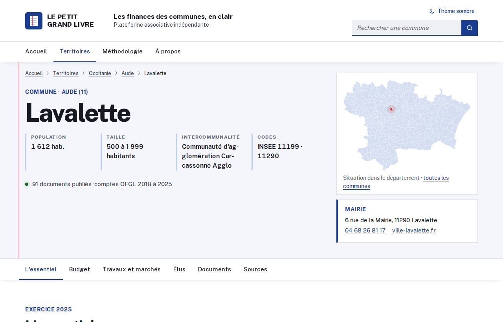
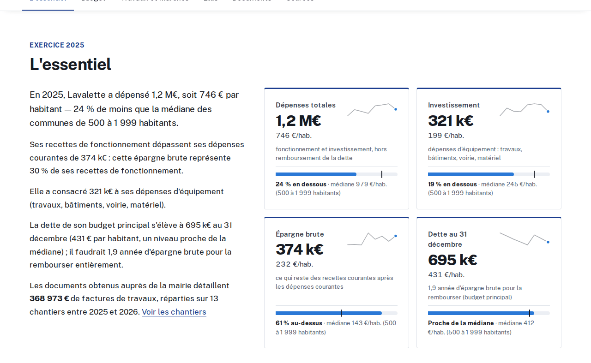
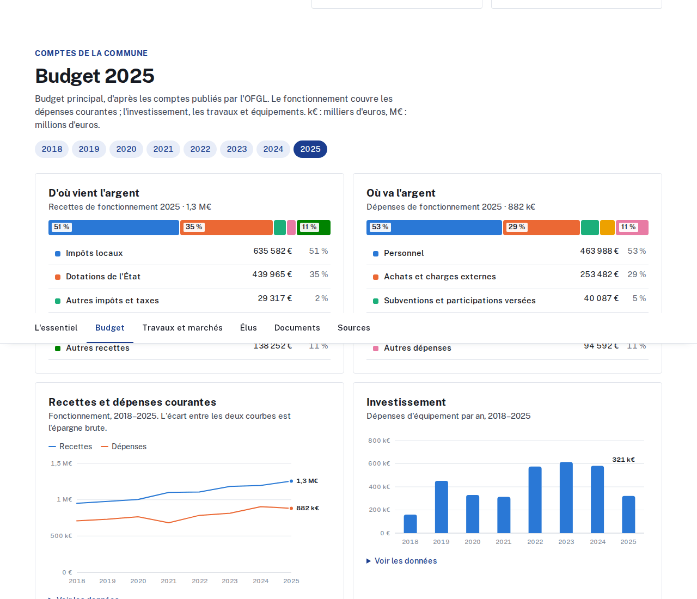
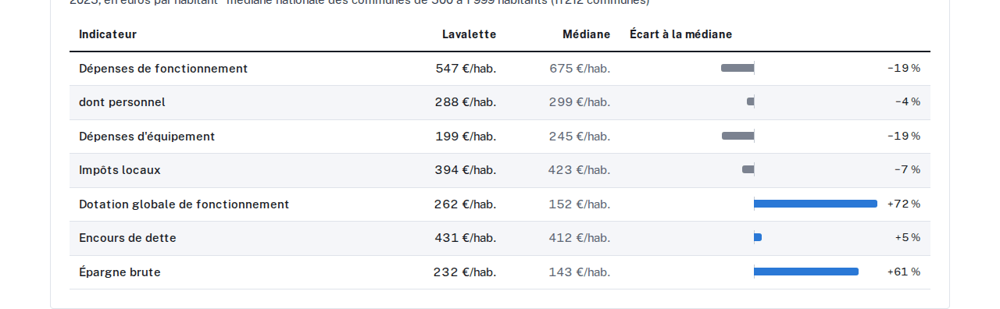
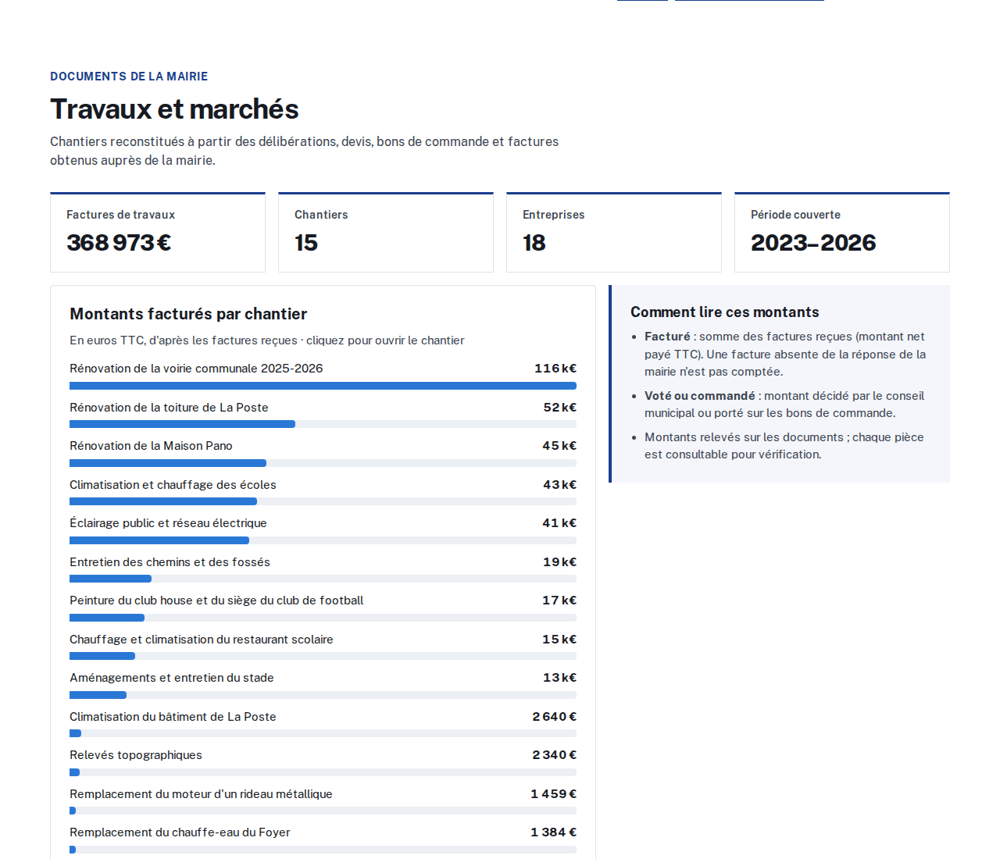
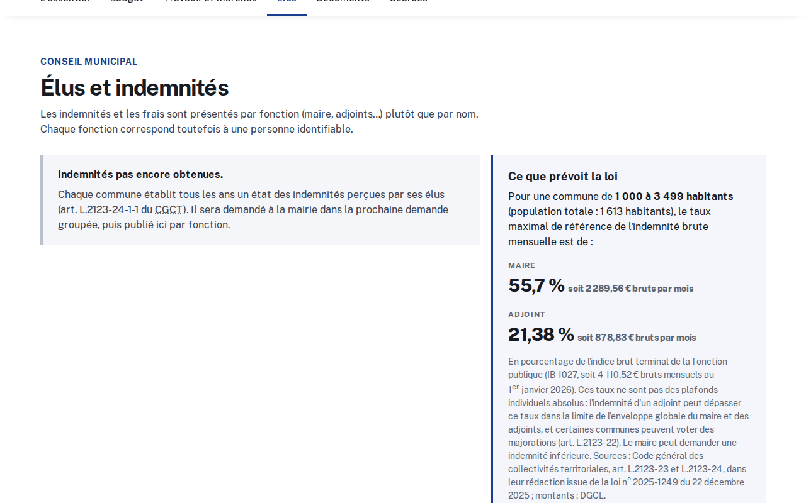
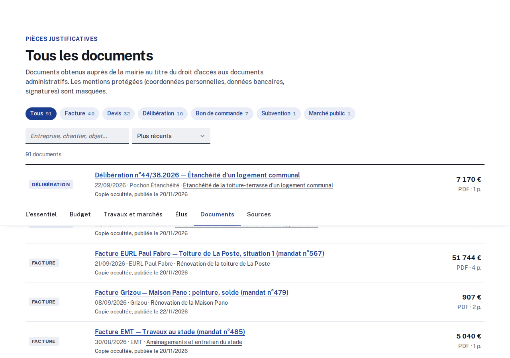
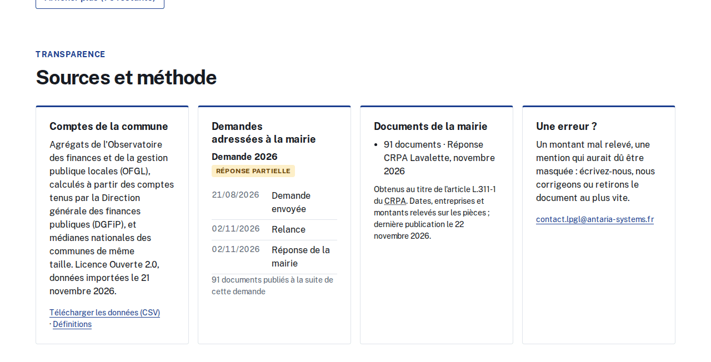

# Guide de lecture d'une fiche commune

Ce guide explique, section par section, ce que montre une fiche commune du Petit Grand Livre, d'où viennent les chiffres et comment les interpréter, sans formation en finances publiques.

← [Retour au README](../README.md)

---

## Sommaire

1. [Trouver sa commune](#1-trouver-sa-commune)
2. [L'en-tête de la fiche](#2-len-tête-de-la-fiche)
3. [L'essentiel](#3-lessentiel)
4. [Le budget](#4-le-budget)
5. [La comparaison avec les communes de même taille](#5-la-comparaison-avec-les-communes-de-même-taille)
6. [Travaux et marchés](#6-travaux-et-marchés)
7. [Élus et indemnités](#7-élus-et-indemnités)
8. [Les documents](#8-les-documents)
9. [Sources et méthode](#9-sources-et-méthode)
10. [Lexique](#10-lexique)
11. [Ce que les chiffres ne disent pas](#11-ce-que-les-chiffres-ne-disent-pas)

---

## 1. Trouver sa commune

Trois chemins mènent à une fiche :

- **La recherche** (page d'accueil ou en-tête de chaque page) : tapez le nom de la commune ou son code postal. Les abréviations « St » et « Ste » sont comprises, et une petite faute de frappe (« carcasone ») est tolérée. Flèches, Entrée et Échap fonctionnent au clavier.
- **Les territoires** : « Territoires » dans le menu, puis la région, puis le département. La page d'un département liste toutes ses communes par ordre alphabétique, avec un filtre et un index des lettres.
- **Un lien partagé** : chaque fiche a une adresse stable, de la forme `/communes/lavalette-11199` (nom puis code INSEE).

| Recherche | Département |
|---|---|
|  |  |

> **Commune non couverte ?** La plateforme s'étend département par département. Pour un département pas encore couvert, la page renvoie vers les comptes publiés par l'OFGL.

---

## 2. L'en-tête de la fiche

- **Fil d'Ariane** : Accueil › Territoires › Région › Département › Commune.
- **Faits clés** : population (municipale, Insee), strate de taille, intercommunalité, codes INSEE et postaux.
- **Compteur** : nombre de documents de la mairie publiés, et années de comptes OFGL disponibles (par exemple « comptes OFGL 2018 à 2025 »).
- **Carte de situation** : la commune dans son département.
- **Coordonnées de la mairie** : adresse, téléphone et site, d'après l'Annuaire de l'administration.

Sous l'en-tête, une **barre d'onglets** reste visible pendant la lecture (L'essentiel, Budget, Travaux et marchés, Élus, Documents, Sources). Sur mobile, elle défile horizontalement et suit la section en cours.

---

## 3. L'essentiel

Le bloc « L'essentiel » résume l'exercice choisi (par défaut, le dernier disponible) :

- **Quelques phrases** en langage courant, par exemple : « En 2025, Lavalette a dépensé 1,2 M€, soit 746 € par habitant, 24 % de moins que la médiane des communes de 500 à 1 999 habitants. »
- **Quatre tuiles** :

| Tuile | Ce qu'elle mesure | Comment la lire |
|---|---|---|
| Dépenses totales | Tout ce que la commune a dépensé dans l'année (fonctionnement et investissement), hors remboursement du capital des emprunts. | Le volume de l'action communale. À rapporter au nombre d'habitants pour comparer. |
| Investissement | Les dépenses d'équipement : travaux, bâtiments, voirie, véhicules, matériel. | Varie beaucoup d'une année sur l'autre (un gros chantier fait un pic). |
| Épargne brute | Ce qui reste des recettes courantes une fois payées les dépenses courantes. | C'est la marge de manœuvre : elle finance l'investissement et rembourse la dette. Négative, elle signale une tension. |
| Dette au 31 décembre | Le capital restant dû des emprunts du budget principal. | Lue avec la **capacité de désendettement** : le nombre d'années d'épargne brute qu'il faudrait pour tout rembourser. |

Chaque tuile indique la position par rapport à la **médiane** des communes de la même strate (voir [section 5](#5-la-comparaison-avec-les-communes-de-même-taille)).

Si des factures ont été obtenues, une dernière phrase indique leur total, le nombre de chantiers concernés et les années couvertes.

> **Capacité de désendettement**, repère courant : en dessous de 8 années, la situation est généralement considérée comme confortable ; au-delà de 12, comme tendue. Ce repère dépend toutefois du contexte (gros investissement récent, emprunt pour un équipement durable…).

---

## 4. Le budget

La section Budget porte sur le **budget principal** de la commune. Les budgets annexes (eau, assainissement…) n'y figurent pas ; ils sont dans l'export CSV. Un sélecteur permet de changer d'exercice (2018 à la dernière année publiée).

| Graphique | Ce qu'il montre |
|---|---|
| **D'où vient l'argent** | La composition des recettes de fonctionnement : impôts locaux, dotations de l'État, autres impôts et taxes, ventes et services, autres recettes. |
| **Où va l'argent** | La composition des dépenses de fonctionnement : personnel, achats et charges externes, subventions et participations versées, intérêts de la dette, autres dépenses. |
| **Recettes et dépenses courantes** | L'évolution du fonctionnement depuis 2018. L'écart entre les deux courbes est l'épargne brute. |
| **Investissement** | Les dépenses d'équipement année par année. |
| **Dette par habitant** | L'encours de dette rapporté à la population, comparé à la médiane de la strate. |

Chaque graphique a un lien **« Voir les données »** qui affiche le tableau des valeurs. Les lecteurs d'écran annoncent un résumé de chaque graphique.

> **k€ et M€** : k€ signifie milliers d'euros (45 k€ = 45 000 €), M€ millions d'euros (1,3 M€ = 1 300 000 €).

---

## 5. La comparaison avec les communes de même taille

Comparer le budget de Carcassonne à celui d'un village n'aurait pas de sens. La fiche compare donc la commune à la **médiane nationale** des communes de sa **strate** de population (même tranche de taille, d'après l'OFGL), en euros par habitant.

- **Médiane** : la valeur du milieu. La moitié des communes de la strate est au-dessus, l'autre moitié en dessous. Contrairement à la moyenne, elle n'est pas tirée par quelques communes atypiques.
- **Écart** : en pourcentage, au-dessus (+) ou en dessous (−) de la médiane. La barre est bleue au-dessus, gris-bleu en dessous.

> **Un écart n'est pas un jugement.** Une épargne plus élevée que la médiane est plutôt un signe de bonne santé ; des dépenses de personnel plus élevées peuvent s'expliquer par des services en régie (cantine, crèche) que d'autres communes externalisent. Les couleurs sont volontairement neutres.

Strates utilisées : moins de 100 habitants, 100 à 199, 200 à 499, 500 à 1 999, 2 000 à 3 499, 3 500 à 4 999, 5 000 à 9 999, 10 000 à 19 999, 20 000 à 49 999, 50 000 à 99 999, 100 000 et plus.

---

## 6. Travaux et marchés

Cette section n'existe que lorsque des documents ont été obtenus auprès de la mairie. Les **chantiers** y sont reconstitués à partir des pièces :

- **Délibérations** du conseil municipal (décision, montant voté) ;
- **Devis** acceptés et **bons de commande** ;
- **Factures** (montant net payé, TTC).

Pour chaque chantier : sa catégorie, son lieu, l'entreprise, le montant voté ou commandé, le montant facturé, la période, et la liste des pièces, chacune consultable. Le classement en haut de section montre les montants facturés par chantier.

- **Facturé** : somme des factures reçues. Une facture absente de la réponse de la mairie n'est pas comptée.
- **Voté ou commandé** : montant décidé par le conseil ou porté sur les bons de commande.
- **Second exemplaire** : un document reçu deux fois n'est compté qu'une fois.

Sur une fiche longue, seuls les 5 premiers chantiers sont dépliés ; le bouton « Afficher les autres chantiers » montre le reste.

---

## 7. Élus et indemnités

- **Indemnités de fonction** : montants bruts annuels et mensuels, **par fonction** (maire, adjoints, conseillers délégués), d'après l'état annuel que chaque commune doit établir (article L.2123-24-1-1 du CGCT).
- **Frais** : déplacements, missions, représentation, formation, par fonction et par nature.
- **Ce que prévoit la loi** : le taux maximal de référence pour la taille de la commune, en pourcentage de l'indice brut terminal de la fonction publique (IB 1027) et en euros bruts mensuels, selon le barème issu de la loi n° 2025-1249 du 22 décembre 2025.

> **Ce ne sont pas des plafonds individuels absolus.** L'indemnité d'un adjoint peut dépasser le taux de référence dans la limite de l'enveloppe globale du maire et des adjoints ; certaines communes peuvent voter des majorations (chef-lieu de canton, commune touristique…) ; le maire peut demander moins. La plateforme ne signale donc jamais automatiquement un « dépassement ». La tranche de population retenue est celle de la **population totale**, qui sert de référence légale.

Les délibérations publiées, documents publics, mentionnent les élus par leur nom, comme dans leur version officielle.

---

## 8. Les documents

Tous les documents publiés pour la commune, avec :

- un **filtre par type** (facture, devis, délibération, budget…) et une **recherche** (entreprise, chantier, objet) ;
- un **tri** par date ou par montant ;
- pour chaque pièce : sa date, l'entreprise, le chantier, le montant relevé et sa date de publication.

Chaque document s'ouvre en PDF. Ce sont des **copies occultées** :

- les coordonnées personnelles, les données bancaires et les signatures sont recouvertes de noir ;
- la page est reconstruite en image, donc aucun texte ne subsiste sous les masques ;
- une ligne en bas de chaque page rappelle « Copie occultée publiée par Le Petit Grand Livre […]. Ne vaut pas original. »

---

## 9. Sources et méthode

En bas de chaque fiche :

- **Comptes de la commune** : source (OFGL, d'après les comptes de la DGFiP), licence et date d'import ; lien de téléchargement des données en **CSV**.
- **Demandes adressées à la mairie** : la chronologie de chaque demande (envoi, relance, réponse, saisine de la CADA, avis), et le nombre de documents publiés à sa suite.
- **Documents de la mairie** : lots reçus et date de la dernière publication.

La méthodologie complète est sur [la page Méthodologie](https://lpgl.antaria-systems.fr/methodologie) du site, et dans [docs/donnees-financieres.md](donnees-financieres.md).

---

## 10. Lexique

| Terme | Définition |
|---|---|
| **Budget principal** | Le budget général de la commune. Certaines activités (eau, assainissement, lotissements) ont des budgets annexes séparés. |
| **Fonctionnement** | Les dépenses et recettes courantes, qui reviennent chaque année : salaires, entretien, énergie, impôts, dotations. |
| **Investissement** | Les dépenses qui enrichissent le patrimoine : travaux, bâtiments, équipements ; et leur financement (subventions, emprunts, épargne). |
| **Épargne brute** | Recettes de fonctionnement moins dépenses de fonctionnement. |
| **Épargne nette** | Épargne brute moins le remboursement du capital de la dette de l'année. |
| **Encours de dette** | Capital restant dû au 31 décembre. |
| **Capacité de désendettement** | Encours de dette divisé par l'épargne brute, en années. |
| **Dotation globale de fonctionnement (DGF)** | La principale dotation versée par l'État aux communes. |
| **Strate** | Tranche de population utilisée pour comparer des communes de taille comparable. |
| **Médiane** | Valeur qui partage les communes d'une strate en deux moitiés égales. |
| **OFGL** | Observatoire des finances et de la gestion publique locales : il publie les comptes de toutes les collectivités en open data. |
| **DGFiP** | Direction générale des finances publiques : elle tient les comptes des communes, d'où proviennent les données de l'OFGL. |
| **CRPA** | Code des relations entre le public et l'administration : il fonde le droit d'accès aux documents administratifs (article L.311-1). |
| **CADA** | Commission d'accès aux documents administratifs : elle rend un avis quand une administration refuse ou ne répond pas. |
| **CGCT** | Code général des collectivités territoriales. |
| **IB 1027** | Indice brut terminal de la fonction publique, base de calcul des indemnités des élus (4 110,52 € bruts mensuels au 1er janvier 2026). |
| **Occultation** | Masquage des mentions protégées par la loi avant publication. |

---

## 11. Ce que les chiffres ne disent pas

- **Une année isolée trompe souvent.** Un investissement important, une subvention reçue en retard ou un emprunt ponctuel déforment un exercice ; regardez l'évolution sur plusieurs années.
- **La médiane n'est pas une norme.** Chaque commune a ses choix (services en régie ou délégués, patrimoine à entretenir, tourisme…).
- **Le budget principal n'est pas tout.** Les budgets annexes et l'intercommunalité portent une partie des services ; leur répartition varie d'une commune à l'autre.
- **Les documents publiés ne sont que ceux reçus.** Une facture absente de la réponse de la mairie n'apparaît pas dans les totaux.
- **Une erreur reste possible.** Les montants des documents sont relevés à la main ; signalez toute erreur à contact.lpgl@antaria-systems.fr, elle sera corrigée.
