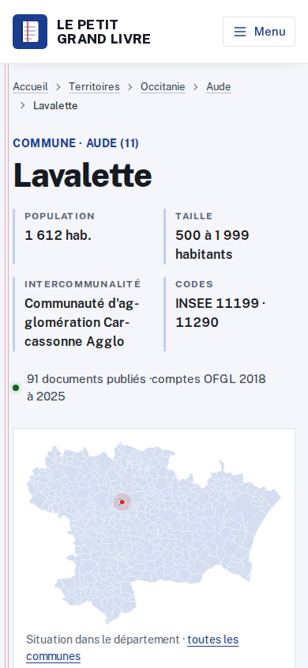
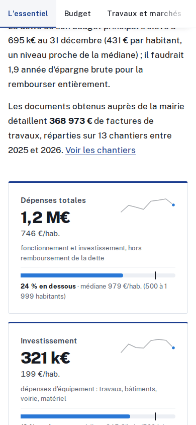

# Interface et accessibilité

L'identité visuelle de la plateforme, ses composants, ses graphiques, et ce qui est fait pour l'accessibilité et le référencement.

← [Retour au README](../README.md)

---

## Sommaire

1. [Identité visuelle](#1-identité-visuelle)
2. [Couleurs et thèmes](#2-couleurs-et-thèmes)
3. [Typographie et rédaction](#3-typographie-et-rédaction)
4. [Composants](#4-composants)
5. [Graphiques](#5-graphiques)
6. [Accessibilité](#6-accessibilité)
7. [Mobile](#7-mobile)
8. [Animations](#8-animations)
9. [Impression](#9-impression)
10. [Référencement et partage](#10-référencement-et-partage)
11. [Où modifier quoi](#11-où-modifier-quoi)

---

## 1. Identité visuelle

L'interface s'inspire des **conventions des services publics numériques** (en-tête sobre, fil d'Ariane, tuiles, encarts, formulaires lisibles), sans reprendre le système de design de l'État (DSFR), sa police Marianne ni son bloc-marque, réservés aux sites de l'État. L'identité est propre à l'association :

- **le grand livre** : le logo représente une page de registre comptable (lignes bleues, marge rouge) ; le même motif (lignes horizontales et double marge rouge) habille le bandeau de l'accueil et l'en-tête des fiches ;
- **le bleu registre** `#1b3d8f`, distinct du bleu de l'État ;
- la mention **« Plateforme associative indépendante »** dans l'en-tête.

---

## 2. Couleurs et thèmes

Les couleurs sont des variables CSS (`src/app/globals.css`) :

| Variable | Clair | Usage |
|---|---|---|
| `--brand` | `#1b3d8f` | Liens, boutons principaux, éléments actifs |
| `--brand-hover`, `--brand-active` | `#142f73`, `#0f255c` | États des boutons |
| `--rouge` | `#c62f3a` | Marge du registre, repère sur les cartes |
| `--ink` | `#161a22` | Texte principal |
| `--muted` | `#5d6573` | Texte secondaire |
| `--line`, `--line-strong` | `#dfe3ea`, `#b9c0cc` | Filets, bordures |
| `--champ-bg` | `#eef0f4` | Fond des champs de saisie (avec un trait inférieur) |
| `--focus` | `#0a6cdb` | Contour de focus (2 px) |
| `--admin-bg` | `#13265a` | Barre de l'administration |

**Thème sombre** : suit le réglage du système (`prefers-color-scheme`) ou le choix du visiteur (bouton « Thème sombre / clair », mémorisé dans le navigateur, appliqué avant l'affichage pour éviter un flash). Chaque variable a sa valeur sombre (par exemple `--brand` devient `#8fa9f5`).

---

## 3. Typographie et rédaction

- **Police** : Public Sans (licence SIL OFL), auto-hébergée par `next/font`, chargée en `display: swap`.
- **Hiérarchie** : un seul `h1` par page, titres de section avec surtitre en petites capitales.
- **Chiffres** : chiffres tabulaires (`.chiffres`) dans les tableaux et tuiles.
- **Typographie française** : espaces insécables avant `: ; ? !` et dans les nombres (« 1 612 hab. », « 55,7 % »), guillemets « », accords au singulier sous 2 (« 1,9 année »), élisions (« de l'Aude », « d'Aigues-Vives »).
- **Ton** : langage courant, phrases courtes, sigles développés à leur première apparition ou dans une infobulle (`<abbr>`), aucun qualificatif de jugement sur les chiffres.

---

## 4. Composants

| Composant | Fichier | Rôle |
|---|---|---|
| En-tête | `components/EnteteSite.tsx`, `Entete.tsx` | Marque, devise, thème, recherche, navigation ; menu plein écran sous 992 px ; liens d'évitement. |
| Pied de page | `components/Pied.tsx` | Colonnes de liens, mention d'indépendance, sources, licences, code source. |
| Recherche | `components/RechercheCommune.tsx` | Combobox ARIA (flèches, Entrée, Échap), variantes « grande » et « compacte », repli sans JavaScript vers `/recherche`. |
| En-tête de page | `components/EnTetePage.tsx`, `FilAriane.tsx` | Bandeau, fil d'Ariane, chapô, visuel latéral (carte). |
| Fiche commune | `components/fiche/*` | En-tête, barre d'onglets qui suit la lecture, sections, bibliothèque de documents, chantiers. |
| Filtre des communes | `components/FiltreCommunes.tsx` | Filtre instantané (rendu différé), index alphabétique. |
| Administration | `components/admin/*` | Formulaires reliés aux actions serveur (confirmation par bouton), éditeur d'occultation, dépôt, recherche Ctrl+K. |
| Images de partage | `components/og/LogoOg.tsx`, `app/opengraph-image.tsx` | Carte 1200 × 630 générée. |

Éléments génériques (classes CSS) : `.bouton`, `.bouton-principal`, `.carte`, `.tuile`, `.encart`, `.badge` (statuts toujours accompagnés d'un libellé), `.alerte-{info,attention,urgent}`, `.champ`, `.vide` (états vides explicites).

---

## 5. Graphiques

Les graphiques sont des composants SVG maison (`components/graphiques/`), sans bibliothèque :

| Graphique | Usage |
|---|---|
| `BarreSegmentee` | Composition des recettes et des dépenses (parts). |
| `GraphiqueLignes` | Évolution des recettes et dépenses de fonctionnement ; navigation au clavier (← →), infobulle annoncée. |
| `GraphiqueColonnes` | Investissement, dette par habitant ; étiquettes positionnées pour ne pas chevaucher les colonnes voisines. |

Règles :

- palette de séries **vérifiée pour les daltonismes** et pour les deux thèmes ;
- pourcentages écrits dans les parts sur une **pastille claire**, lisibles quelle que soit la couleur ;
- écarts à la médiane en **deux teintes neutres** (bleu au-dessus, gris-bleu en dessous), jamais rouge et vert ;
- chaque graphique a une **alternative** : un résumé pour les lecteurs d'écran (`role="img"` + `aria-label`) et un tableau « Voir les données » ;
- largeur mesurée côté client ; avant cela, le SVG se réduit (`viewBox`) au lieu de déborder.

---

## 6. Accessibilité

Référentiel visé : **RGAA 4.1 / WCAG 2.2 niveau AA**.

| Thème | Ce qui est fait |
|---|---|
| Structure | `lang="fr"`, repères (`header`, `nav`, `main`, `footer`) nommés, titres hiérarchisés, titres de page uniques (404 comprise). |
| Clavier | Liens d'évitement (Contenu, Menu, Pied de page), focus visible partout (2 px), ordre logique ; menu mobile **modal** (focus gardé dans le menu, reste de la page inerte, Échap) ; éditeur d'occultation entièrement au clavier. |
| Lecteurs d'écran | Combobox ARIA, `aria-live` sur les compteurs, graphiques résumés, liens PDF annoncés (« PDF, 2 pages »), liens externes annoncés (« nouvel onglet »), tableaux avec en-têtes de ligne et légendes. |
| Contrastes | Textes de 4,8:1 à 17:1 dans les deux thèmes ; traits de champs contrastés. |
| Texte agrandi et zoom | Grilles en `rem`, coupure des mots longs, aucune hauteur fixe sur les éléments de texte ; pas de défilement horizontal de 320 à 1440 px. |
| Couleurs forcées (Windows) | Contours de champs et états actifs conservés (`@media (forced-colors: active)`). |
| Mouvement | Animations courtes, jamais nécessaires à la compréhension, toutes coupées si l'utilisateur limite les animations (`prefers-reduced-motion`) ; aucun mouvement automatique ne dure plus de 5 s. |
| Sans JavaScript | Recherche et navigation mobile utilisables. |

---

## 7. Mobile

| Fiche | L'essentiel | Menu |
|---|---|---|
|  |  |  |

- Menu plein écran sous 992 px ; recherche intégrée.
- Barre d'onglets de la fiche défilante, avec un fondu qui signale la suite, et qui garde l'onglet actif visible.
- Tableau de comparaison présenté en cartes sous 600 px.
- Les 5 premiers chantiers dépliés, les autres sur demande.

---

## 8. Animations

Toutes les animations sont décrites dans `globals.css` (jetons `--duree-rapide`, `--duree`, `--courbe`, `--courbe-sortie`) et coupées par `prefers-reduced-motion: reduce`.

| Où | Ce qui se passe |
|---|---|
| Défilement | Les blocs (tuiles, graphiques, chantiers, cartes, étapes) montent en fondu à leur arrivée dans la fenêtre, l'un après l'autre dans une grille ; les colonnes poussent depuis la ligne de base, les courbes se tracent, les barres s'allongent, la barre de composition se dévoile. |
| Fiche | Un filet rouge (la marge du grand livre) suit la lecture sous les onglets ; le repère de la carte bat deux fois à l'arrivée ; un chantier atteint depuis le classement est surligné. |
| Accueil et fiche | La double marge rouge se trace à l'arrivée ; l'encart des chiffres monte. |
| Survol | Cartes et tuiles légèrement soulevées, flèches qui avancent, soulignement du menu qui se déploie, ligne de tableau repérée. |
| Commandes | Trait des champs épaissi au focus ; liste de recherche, menu mobile et infobulles en fondu ; dépliants « Voir les données » animés ; fondu enchaîné au changement de thème (View Transitions). |

**Apparition au défilement** : le composant `components/Apparition.tsx` (monté dans la mise en page du site public) marque `data-apparition="attente"` les blocs situés sous l'écran au chargement, puis `"vu"` à leur arrivée (IntersectionObserver). Ce qui est déjà visible ne bouge pas ; sans JavaScript, rien n'est masqué. Les marques des graphiques portent les classes `colonne`, `trace` (avec `pathLength={1}`) et `fin`. La liste des blocs concernés est la constante `CIBLES` du composant.

La barre de lecture et les dépliants animés utilisent des fonctions récentes (animations liées au défilement, `::details-content`) : les navigateurs qui ne les gèrent pas affichent simplement la page sans ces effets.

---

## 9. Impression

Une fiche imprimée garde l'identité, les chiffres clés, les graphiques et les documents ; l'en-tête est réduit à la marque, la navigation, la recherche et les commandes disparaissent. Le thème sombre est réservé à l'écran (`@media screen`) : l'impression sort toujours en clair, avec les couleurs des graphiques conservées (`print-color-adjust: exact`).

---

## 10. Référencement et partage

### Moteurs de recherche

- **Titres** pensés pour les recherches courantes : « Lavalette (11290) : budget, dette et travaux », « Communes de l'Aude (11) : budget, dette et documents ». Le code postal départage les homonymes.
- **Descriptions chiffrées** propres à chaque fiche : population, dépenses et dette par habitant du dernier exercice, nombre de documents publiés.
- **Adresses canoniques** sur toutes les pages ; `?annee=` neutralisé sur les fiches. Les adresses approchantes (`/communes/lavalette`, `/communes/11199`) redirigent (308) vers la fiche quand elles désignent une seule commune.
- **Données structurées** (schema.org, JSON-LD) :
  - accueil : `WebSite` (nom affiché dans les résultats, sigle LPGL, recherche de communes) et `NGO` (l'association éditrice) ;
  - toutes les pages à fil d'Ariane : `BreadcrumbList`, que les moteurs affichent à la place de l'adresse ;
  - fiches : `WebPage`, `City` (code Insee, code postal, département) et `Dataset` (comptes OFGL, licence, export CSV), repris par Google Dataset Search.
- **Maillage** : chaque fiche liste les autres communes de son intercommunalité (repliée au-delà de 24).
- **`/sitemap.xml`** : pages fixes, territoires couverts, toutes les fiches des départements couverts (date de dernière modification ou publication). Annoncé dans **`/robots.txt`** (administration, API, connexion et recherche exclues).
- **IndexNow** : le worker `envois` signale toutes les 10 minutes les fiches modifiées (import des comptes, présentation) ou ayant reçu un document publié, avec leur département et l'accueil ; la première fois, tout le plan du site. Bing, Yandex, Seznam, Naver et Yep le reçoivent ; DuckDuckGo, Qwant, Ecosia et Yahoo s'appuient sur l'index de Bing. Clé : `INDEXNOW_KEY`, publiée en `/<clé>.txt`. Google n'y participe pas : il lit le plan du site.
- **Outils pour webmestres** : codes `GOOGLE_SITE_VERIFICATION`, `BING_SITE_VERIFICATION`, `YANDEX_VERIFICATION` (balises meta), si le domaine n'est pas validé par DNS.
- **Pages non couvertes** (département ou région sans couverture) en `noindex`.
- **OpenSearch** (`/opensearch.xml`) : la recherche de communes s'ajoute aux moteurs du navigateur.

### Aperçus de partage

Discord, Facebook, LinkedIn, WhatsApp, Telegram, Slack, X, iMessage : titre, description, adresse et grande image (Open Graph, carte `summary_large_image`) sur toutes les pages ; liseré bleu sur Discord (`theme-color`).

- **Images** : une par défaut, une par département (communes, habitants, documents publiés), une par fiche (nom, département, population, dette par habitant, documents publiés).

  

- **Icônes** : `icon.svg`, icône Apple 180 px, manifeste web.

> `robots.txt`, le manifeste et l'image par défaut sont rendus à la requête (`dynamic = "force-dynamic"`) : à la construction de l'image Docker, `SITE_URL` et `SITE_NAME` ne sont pas connues.

---

## 11. Où modifier quoi

| Je veux changer… | Fichier |
|---|---|
| Une couleur, un espacement, un composant visuel | `src/app/globals.css` |
| Le logo | `src/components/Icones.tsx` (`LogoRegistre`), `src/app/icon.svg`, `src/components/og/LogoOg.tsx` |
| L'en-tête, le menu, le pied de page | `src/components/EnteteSite.tsx`, `src/components/Pied.tsx` |
| Un texte de l'accueil, de la méthodologie, des mentions | `src/app/(site)/page.tsx`, `methodologie/page.tsx`, `mentions-legales/page.tsx` |
| Les phrases de « L'essentiel » | `src/lib/resume.ts` |
| Un graphique | `src/components/graphiques/` |
| Une animation, les blocs qui apparaissent au défilement | `src/app/globals.css` (« Apparition au défilement », « Animations »), `src/components/Apparition.tsx` |
| Le barème des indemnités | `src/components/fiche/SectionElus.tsx` |
| Les images de partage | `src/app/opengraph-image.tsx`, `src/app/(site)/communes/[slug]/opengraph-image.tsx`, `src/app/(site)/departements/[code]/opengraph-image.tsx` |
| Titres, descriptions, données structurées | `src/lib/seo.ts`, `generateMetadata` de chaque page |
| Le signalement aux moteurs (IndexNow) | `src/lib/indexnow.ts`, `scripts/worker.ts` |
